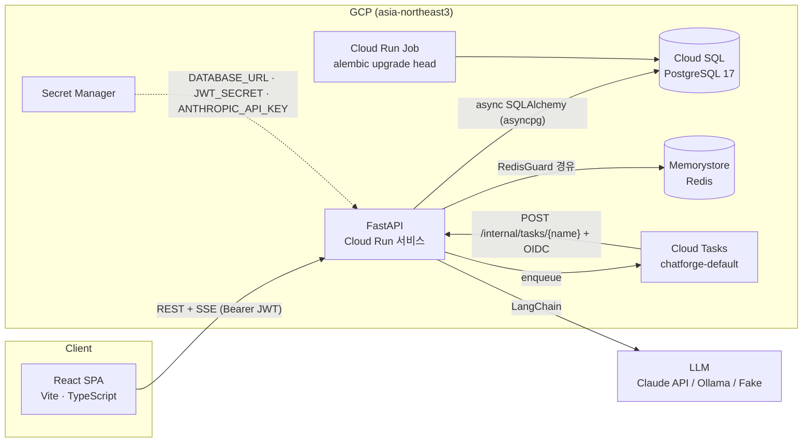
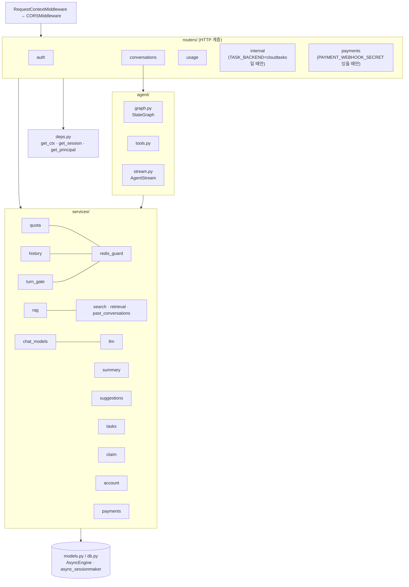
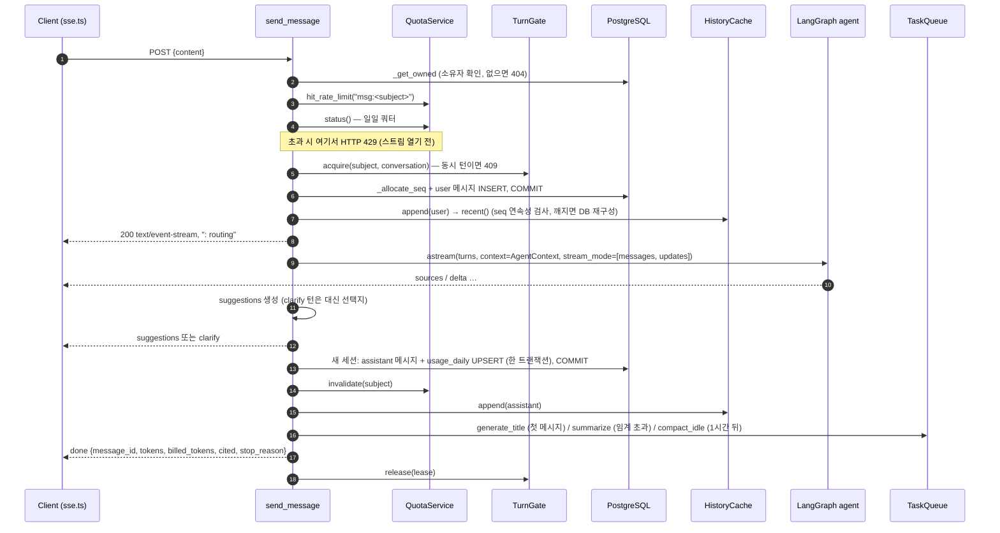
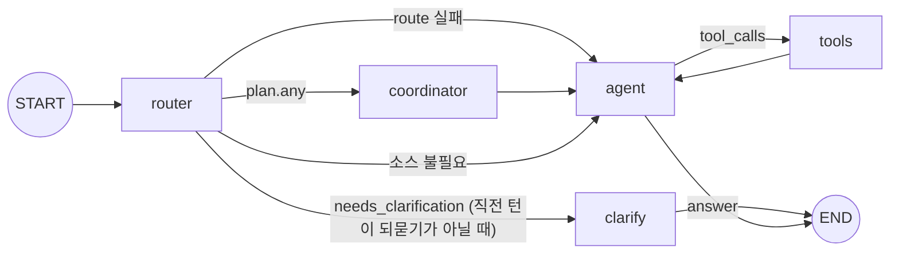
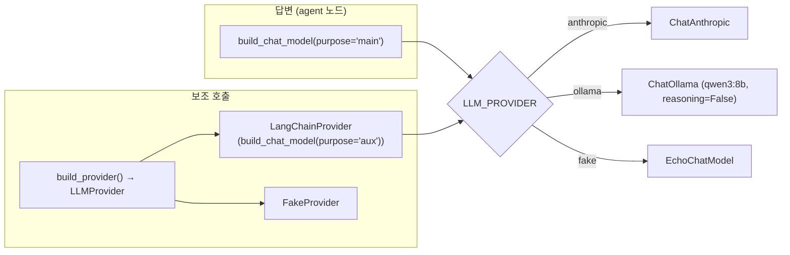
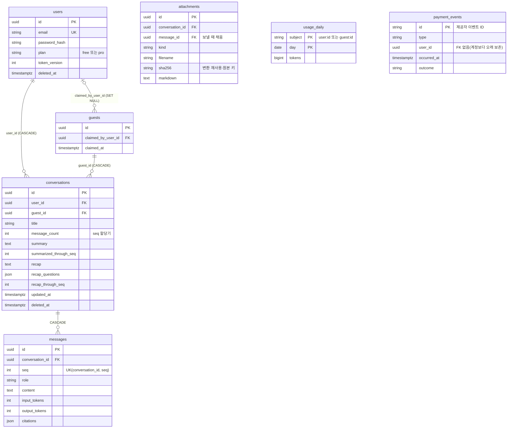
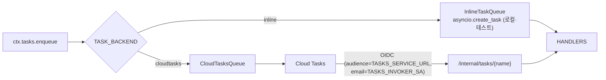
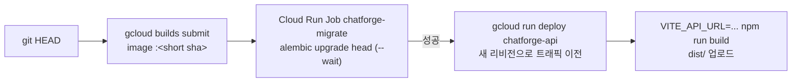

# Chatforge 아키텍처

이 문서는 코드가 **어떻게 짜여 있고 요청이 어디를 거쳐 흐르는지**를 설명합니다.
각 설계의 배경과 측정치(왜 이렇게 했는가)는 [README의 설계 포인트](README.md#설계-포인트)에 있으므로 여기서는 링크만 겁니다.

> 기준 커밋: `6865e92` (2026-11-04). 코드와 이 문서가 다르면 코드가 맞습니다.
> 설정 기본값·타임아웃 같은 수치는 낡기 쉬워서 적지 않고 원본 파일로 링크합니다.

---

## 1. 시스템 구성



| 구성 요소 | 역할 | 기준값인가 |
|---|---|---|
| PostgreSQL | 사용자·게스트·대화·메시지·사용량·결제 이벤트 | **예** (모든 정합성의 기준) |
| Redis | 쿼터 캐시, rate limit, 히스토리 캐시, 턴 입장 제어 | 아니오. 장애 시 DB로 fallback하거나 fail-open |
| Cloud Tasks | 제목 생성, 대화 요약(비활성 압축은 1시간 지연), 탈퇴 계정 정리 | 아니오. at-least-once, 핸들러 멱등 |
| LLM | 답변(에이전트) + 보조 호출(라우팅·압축·추천 질문·제목·요약) | — |
| Tavily | agent의 `search_web` 도구 (선택, `WEB_SEARCH_ENABLED`) | 아니오. 사용자별 일일 상한, Redis 장애 시 fail closed |
| 지식 베이스 | `backend/knowledge/*.md`를 부팅 시 BM25로 색인 | 프로세스 메모리 |

로컬은 `docker-compose.yml`이 Postgres·Redis·마이그레이션·API를 띄우고, 프론트엔드는 `npm run dev`로 따로 실행합니다. 기본 `LLM_PROVIDER=fake`라서 API 키 없이 동작합니다.

---

## 2. 저장소 구조

```
backend/
  app/
    main.py            앱 팩토리(create_app), lifespan에서 AppContext 조립
    context.py         AppContext: 프로세스 전역 의존성 묶음
    deps.py            FastAPI 의존성: get_ctx, get_session, get_principal, client_ip
    config.py          Settings (pydantic-settings, 환경변수/.env)
    models.py          SQLAlchemy 모델
    schemas.py         요청·응답 Pydantic 스키마
    errors.py          ApiError(status, code, message)
    security.py        비밀번호 해시, JWT 발급·검증
    observability.py   JSON 로그 포맷터, RequestContextMiddleware
    routers/           HTTP 계층 (auth, conversations, usage, internal, payments)
    agent/             LangGraph 에이전트 (graph, tools, stream)
    services/          도메인 로직 (quota, history, rag, search, summary, tasks …)
  knowledge/           도움말 문서(RAG 코퍼스)
  migrations/          Alembic 0001 ~ 0007
  tests/               pytest (conftest.Harness로 HTTP 수준 테스트, fakes.py)
frontend/src/          React SPA (api.ts, sse.ts, components/)
deploy/                setup-gcp.sh(리소스 생성), deploy.sh(빌드·마이그레이션·배포)
decision-docs/         결정 기록(records.jsonl), spec, ADR
plan/                  작업 계획 문서 (결정 기록의 doc_refs가 가리킴)
scripts/decisions.py   결정 기록 검증 CLI
```

---

## 3. 백엔드 계층



### 의존성 조립: `AppContext`

[`main.py`](backend/app/main.py)의 lifespan이 프로세스당 한 번 아래 객체를 만들어 `app.state.ctx`에 둡니다. 라우트는 `Depends(get_ctx)`로만 받고, 라우트 안에서 엔진·Redis·LLM 클라이언트를 만들지 않습니다.

| 필드 | 구현 | 비고 |
|---|---|---|
| `engine`, `sessionmaker` | SQLAlchemy async | 요청 세션은 `get_session`, 스트리밍 이후 저장은 별도 세션 |
| `redis`, `redis_guard` | `RedisGuard` | 3상태 서킷 브레이커. Redis 호출은 전부 여기를 거침 |
| `llm` | `LLMProvider` | 보조 호출용. `FakeProvider` 또는 `LangChainProvider` |
| `chat_model` | LangChain `BaseChatModel` | 답변용. `EchoChatModel` / `ChatAnthropic` / `ChatOllama` |
| `agent` | 컴파일된 LangGraph 그래프 | 상태 없음. 요청별 의존성은 `AgentContext`로 주입 |
| `quota` | `QuotaService` | DB 기준 + Redis cache-aside, rate limit |
| `history` | `HistoryCache` | 대화별 최근 메시지 캐시, seq로 누락 검출 |
| `rag` | `RagPipeline` | 라우팅 분류, 소스 병렬 조회, 인용 보존 압축 |
| `suggestions` | `SuggestionService` 또는 `None` | `SUGGESTIONS_ENABLED` |
| `tasks` | `InlineTaskQueue` / `CloudTasksQueue` | `TASK_BACKEND` |
| `turns` | `TurnGate` | 대화당 1턴, 사용자당 동시 스트림 상한 |

`create_app(settings, redis=, llm=, tasks=, search=, chat_model=)`가 이 의존성을 주입받을 수 있어서, 테스트는 fakeredis·`FakeProvider`·`ScriptedChatModel`·기록용 큐를 넣고 실제 HTTP 경로를 탑니다.

종료 시에는 ① 취소된 요청의 저장 작업을 최대 8초 기다리고(`drain_unfinished_writes`) ② 큐 → Redis → 엔진 순으로 닫습니다. Cloud Run의 SIGTERM 유예 10초 안에 끝내기 위한 순서입니다.

### 인증 주체: `Principal`

[`deps.get_principal`](backend/app/deps.py)이 Bearer JWT를 풀어 `Principal(kind, id, plan, email)`을 만듭니다.

- `kind="user"`: `users` 행을 읽고 `deleted_at`, `token_version`(즉시 폐기)을 매 요청 검사합니다.
- `kind="guest"`: 이미 회원에게 이관된 게스트면 `401 guest_claimed`.
- `principal.subject`는 `user:<id>` / `guest:<id>` 문자열이며, 사용량·Redis 키의 소유자 식별자로 씁니다.
- 대화 조회의 소유자 조건은 [`conversations._owned_by`](backend/app/routers/conversations.py) 하나로 통일합니다(삭제된 대화 제외 포함). 지난 대화 검색 도구도 같은 함수를 씁니다.

### 에러 규약

모든 오류는 `ApiError(status, code, message)`로 냅니다. 스트림이 열린 뒤의 실패는 SSE `error` 이벤트로 보냅니다.

프론트엔드의 처리는 두 갈래입니다.

- **401**: `code`(`invalid_token`, `token_revoked`, `guest_claimed` …)와 상관없이 토큰을 버리고 새 게스트 세션으로 한 번 재시도합니다([`api.ts`](frontend/src/api.ts)의 `authedFetch`).
- **그 밖의 오류**: 화면이 `code`로 분기합니다(`quota_exceeded`, `rate_limited`, `invalid_credentials` 등).

---

## 4. API 표면

| 메서드 | 경로 | 설명 |
|---|---|---|
| POST | `/auth/guest` | 게스트 토큰 발급 (IP당 시간당 제한) |
| POST | `/auth/signup`, `/auth/login` | 회원 토큰 발급. 게스트 토큰을 함께 보내면 대화·오늘 사용량 이관 |
| GET | `/auth/me` | 현재 주체 |
| POST | `/auth/logout-all` | `token_version + 1`, 모든 기기 토큰 폐기 |
| DELETE | `/auth/me` | 탈퇴(비밀번호 재확인) → `202`, 정리는 `purge_user` 작업 |
| GET / POST | `/conversations` | 목록(최근 활동순) / 생성 |
| GET / DELETE | `/conversations/{id}` | 상세(메시지 포함) / 소프트 삭제 |
| GET | `/conversations/{id}/recap` | 오래 쉰 대화를 다시 열 때의 recap. 해당 없으면 204 |
| POST | `/conversations/{id}/attachments` | 문서·이미지 업로드(multipart). 빠른 검사 후 202(처리 중), 변환은 `convert_attachment` 작업. 같은 파일이 이미 변환돼 있으면 201(준비됨) |
| GET | `/conversations/{id}/attachments/{aid}` | 첨부 변환 상태(processing·ready·failed와 오류 코드) |
| DELETE | `/conversations` | 전체 소프트 삭제 |
| POST | `/conversations/{id}/messages` | **메시지 전송 → SSE 스트림** |
| GET | `/usage` | 오늘 사용량·한도 |
| POST | `/internal/tasks/{name}` | Cloud Tasks 콜백 (OIDC 검증, 스키마 비공개) |
| POST | `/webhooks/payments` | 결제 웹훅 (HMAC 서명, 스키마 비공개) |
| GET | `/healthz` | DB `SELECT 1` |

---

## 5. 핵심 흐름: 채팅 한 턴

`POST /conversations/{id}/messages` 한 번이 아래 순서로 처리됩니다. 코드: [`routers/conversations.py`](backend/app/routers/conversations.py).



### 실패·취소 처리

| 상황 | 처리 |
|---|---|
| LLM 오류 | 보인 부분까지 저장, 추정 토큰 과금, `error {code, retryable}` |
| 클라이언트 연결 끊김 | `CancelledError` 경로에서 부분 답변 저장·과금. 저장은 `asyncio.shield`로 취소에서 보호 |
| 아무것도 보이기 전에 종료 | user 메시지를 지우고 `message_count`를 되돌림(같은 질문 재시도·제목 생성 보존) |
| 헤더 전송 실패로 본문 제너레이터가 시작조차 안 됨 | `TurnResponse.__call__`의 `finally`가 턴을 되돌리고 lease 반납 |
| 턴 전체 타임아웃 | `AGENT_TURN_TIMEOUT_SECONDS`. Cloud Run 요청 타임아웃(`deploy.sh`의 `--timeout`)보다 짧게 잡아서, 스트림이 잘리는 대신 `error` 이벤트로 끝남 |

### SSE 이벤트 계약

| 이벤트 | 데이터 | 시점 |
|---|---|---|
| `: routing` (주석) | — | 헤더 즉시 플러시 |
| `sources` | `{citations}` | coordinator·도구가 출처를 붙였을 때 |
| `delta` | `{text}` | agent 노드의 토큰 (라우터 호출·도구 라운드 서두는 걸러냄) |
| `suggestions` | `{questions}` | 답변 뒤, 선택 |
| `clarify` | `{options}` | 되묻는 턴의 답 뒤. 빈 배열이면 자유 입력 |
| `done` | `{message_id, input/output/cache 토큰, billed_tokens, cited, stop_reason}` | 저장·과금 완료 후 |
| `error` | `{code, message, retryable}` | 스트림 도중 실패 |

POST라서 `EventSource`를 쓰지 못하고, [`frontend/src/sse.ts`](frontend/src/sse.ts)가 `fetch` + `ReadableStream`으로 파싱합니다(멀티바이트 문자 경계 처리).

---

## 6. LangGraph 에이전트

코드: [`agent/graph.py`](backend/app/agent/graph.py), [`agent/tools.py`](backend/app/agent/tools.py), [`agent/stream.py`](backend/app/agent/stream.py). 배경은 [README 설계 포인트 11](README.md#11-langgraph-에이전트-기본-경로).



router 뒤의 세 갈래는 노드가 아니라 `add_conditional_edges("router", master_router)`의 분기 함수 `master_router`가 정합니다. README와 `graph.py`의 docstring은 이 분기를 `master_router` 박스로 그렸지만 같은 구조입니다.

| 노드 | 하는 일 |
|---|---|
| `router` | `RagPipeline.classify`로 구조화 출력 1회 → `AgentRoute`(검색·계정·지난 대화 필요 여부, 독립 쿼리, 되묻기와 선택지) → `SourcePlan` 확정 |
| `clarify` | 라우터의 되묻는 질문을 그대로 답으로, 선택지를 `clarify` 이벤트로 보냄. 메시지는 `kind="clarify"`로 저장. 이 턴은 추천 질문·요약 제외. 직전 assistant 턴이 되묻기였으면 이 노드로 가지 않고, agent가 현재 턴 context의 안내에 따라 가정을 밝히고 답함 |
| `coordinator` | 계획된 소스(도움말 BM25, 계정 현황, 지난 대화)를 `asyncio.gather`로 병렬 조회, 현재 턴의 `context`에 번호 붙은 출처로 첨부 |
| `agent` | 답변 모델 호출. 도구 라운드가 남았으면 `bind_tools`. 깨진 도구 호출은 도구 없이 1회 재시도. 호출마다 타임아웃 |
| `tools` | 라운드당 최대 `AGENT_MAX_TOOL_CALLS`개를 병렬 실행, 초과분은 에러로 반환, 출처 번호를 이어서 매김 |

도구는 요청마다 [`build_tools`](backend/app/agent/tools.py)가 만듭니다: `search_help`, `search_past_conversations`, `get_account_usage`, `search_web`(켜져 있을 때), `search_attachments`(잘린 첨부 문서가 있을 때). 도구 인자에 사용자 ID가 없고 소유자 필터는 클로저에 고정되므로, 프롬프트 인젝션으로 다른 사용자 데이터에 닿을 수 없습니다.

상태(`AgentState`)의 `usage`, `citations`, `scratch`는 `operator.add` 리듀서로 노드 간 누적됩니다. 과금은 라우터, coordinator의 출처 압축, 모든 agent 라운드, 추천 질문 토큰의 합입니다.

---

## 7. LLM 계층



- 답변 모델과 보조 모델은 `purpose`로 나뉩니다. Anthropic일 때 답변은 `ANTHROPIC_MODEL`·`LLM_MAX_TOKENS`·서버측 refusal fallback, 보조는 `LLM_AUX_MODEL`과 낮은 effort를 씁니다.
- `LLMProvider` 프로토콜은 `complete`(텍스트)와 `structured`(Pydantic 스키마)만 가집니다. 라우팅·RAG 압축·추천 질문·제목·요약이 이걸 씁니다.
- 프롬프트 캐싱(Anthropic만): system 끝, 직전 턴, 최근 도구 결과에 breakpoint. 매 턴 바뀌는 출처는 system이 아니라 현재 user 턴의 `context`에 붙여 prefix를 고정합니다. [설계 포인트 9](README.md#9-토큰-비용-가중-과금과-프롬프트-캐싱).
- 과금 단위는 입력 토큰 환산값입니다: `Usage.billed(settings.token_weights())`. 출력·캐시 쓰기·캐시 읽기 토큰에 가격 비율 가중치(`TOKEN_WEIGHT_*`)를 곱합니다.

---

## 8. 데이터 모델



불변식:

- **`users.plan`은 회원 요금제만**: `free` 또는 `pro`. 게스트는 `users` 행이 없고, 요청 시 `Principal.plan = "guest"`로만 표현됩니다.
- **소유자는 정확히 하나**: `CHECK ((user_id IS NULL) <> (guest_id IS NULL))`.
- **메시지 순서는 `seq`**: `UPDATE conversations SET message_count = message_count + 1 RETURNING`(`_allocate_seq`)으로 원자 할당. `created_at`으로 정렬하지 않습니다.
- **요약과 경계는 한 행에서 함께 갱신**: `summary`와 `summarized_through_seq`는 조건부 UPDATE 한 번으로 바뀝니다.
- **사용량 기준값은 `usage_daily`**: 과금 대상 메시지와 같은 트랜잭션에서 UPSERT, 커밋 후 `quota.invalidate`. [ADR](decision-docs/adrs/database-as-source-of-truth-for-quota.md).
- **결제 멱등**: `payment_events.id` PK + `ON CONFLICT DO NOTHING`.

마이그레이션 이력: `0001` 초기 스키마 → `0002` 게스트 → `0003` 메시지 seq(expand→backfill→contract) → `0004` citations → `0005` 대화 요약 → `0006` token_version → `0007` payment_events → `0008` message kind·options → `0009` conversation recap → `0010` attachments → `0012` attachment status.

---

## 9. Redis 사용

모든 접근은 [`RedisGuard`](backend/app/services/redis_guard.py)를 거칩니다(`call(op, default)`, 패턴 삭제는 `scan_delete` = `SCAN` + `UNLINK`, `KEYS` 금지).

| 키 | 소유 서비스 | 용도 | Redis 장애 시 |
|---|---|---|---|
| `usage:<subject>:<day>` | `QuotaService` | 일일 사용량 캐시(짧은 TTL, 쓰기 시 무효화) | DB 조회로 계속 강제 |
| `rl:<bucket>:<window>` | `QuotaService` | 분당 메시지, 게스트 생성, 가입·로그인 제한 | fail-open |
| `history:<subject>:<conversation>` | `HistoryCache` | 최근 메시지 리스트(`RPUSHX`) | DB에서 구성 |
| `turn:<conversation>` | `TurnGate` | 대화당 1턴 락(`SET NX`, TTL은 턴 타임아웃보다 김). 동시 턴은 `409 stream_in_progress` | fail-open, seq가 순서 보장 |
| `streams:<subject>` | `TurnGate` | 사용자별 동시 스트림 sorted set | fail-open |

브레이커는 세 상태입니다. 연속 연결 실패가 임계치를 넘으면 열림(쿨다운 동안 Redis 미호출), 쿨다운 뒤 반열림(요청 하나만 확인)으로 바뀝니다. 클라이언트 재시도는 끄고 짧은 소켓·연결 타임아웃을 줍니다. 수치는 [`config.py`](backend/app/config.py)의 `REDIS_*`를 보세요. [설계 포인트 2](README.md#2-토큰-쿼터-db가-진실-redis는-캐시), [7](README.md#7-히스토리-캐시와-정합성).

---

## 10. 백그라운드 작업

[`services/tasks.py`](backend/app/services/tasks.py)의 `HANDLERS`가 작업 이름 → 핸들러를 매핑합니다. 모든 핸들러는 재전달에 안전해야 합니다.

| 작업 | 핸들러 | 멱등성 근거 |
|---|---|---|
| `generate_title` | `tasks.generate_title` | `title IS NULL`일 때만 UPDATE (사용자 변경 제목 보존) |
| `summarize_conversation` | `summary.summarize_conversation` | 시작 시점 경계와 같을 때만 요약·경계를 함께 UPDATE |
| `convert_attachment` | `attachments.convert_attachment` | `processing`일 때만 조건부 UPDATE로 결과·과금을 함께 반영 |
| `compact_idle_conversation` | `summary.compact_idle_conversation` | 예약 당시 답변이 아직 마지막 메시지이고 되묻기가 아닐 때만, 같은 조건부 UPDATE로 접음 |
| `purge_user` | `account.purge_user` | 탈퇴 표시된 사용자만, 남은 것만 `PURGE_BATCH_CONVERSATIONS` 단위로 삭제 |



Cloud Run은 응답 후 CPU를 제한할 수 있으므로 운영에서는 in-process 작업에 기대지 않습니다. 핸들러 예외는 500으로 전파돼 Cloud Tasks가 백오프 재시도합니다.

---

## 11. 프론트엔드

| 파일 | 역할 |
|---|---|
| [`api.ts`](frontend/src/api.ts) | 토큰 보관, `authedFetch`(401이면 새 게스트 세션으로 1회 재시도, 동시 호출은 게스트 생성 1회로 합침), SSE 이벤트 디스패치 |
| [`sse.ts`](frontend/src/sse.ts) | 스트리밍 SSE 파서 (`TextDecoder` 스트림 모드 + 버퍼) |
| [`sources.ts`](frontend/src/sources.ts) | 인용된 출처만 표시하는 규칙 |
| [`components/Markdown.tsx`](frontend/src/components/Markdown.tsx) | 답변 마크다운 렌더링(GFM 표). 모델이 쓴 HTML은 버리고(`skipHtml`), 링크는 새 탭. ` ```mermaid `는 스트리밍이 끝난 뒤에만 도식으로, 문법 오류면 원문 코드 |
| [`diagram.ts`](frontend/src/diagram.ts) | mermaid 지연 로딩, `securityLevel: "strict"`, 렌더 전에 `parse`로 검증 |
| [`chips.ts`](frontend/src/chips.ts) | 마지막 메시지 아래 칩 규칙: 되묻기면 답 선택지(빈 배열이면 자유 입력 안내), 답변이면 추천 질문 |
| `components/` | `ChatPanel`, `Sidebar`, `AuthDialog`, `DeleteAccountDialog` |

첫 방문 시 게스트 토큰으로 시작하고, 가입·로그인 때 게스트 토큰을 함께 보내 서버가 이관합니다. 오류 UI는 `ApiError.code`로 분기합니다(예: 게스트의 `quota_exceeded`면 가입 유도).

---

## 12. 배포와 운영



- [`deploy/setup-gcp.sh`](deploy/setup-gcp.sh): Artifact Registry, 서비스 계정 2개(런타임 `chatforge-api`, 태스크 호출 `chatforge-tasks`), Cloud SQL, Memorystore, Cloud Tasks 큐, Secret Manager 시크릿 생성.
- [`deploy/deploy.sh`](deploy/deploy.sh): 마이그레이션 Job이 성공해야 서비스를 배포합니다. CPU·메모리·동시성·인스턴스 수·요청 타임아웃 같은 서비스 사양은 이 스크립트의 `gcloud run deploy` 인자에 있습니다.
- 운영 필수값은 `Settings._check_prod`가 부팅 시 검사합니다: 기본 `JWT_SECRET` 금지, Cloud Tasks 설정 3종, Anthropic 키, Ollama 원격 주소, `TRUSTED_PROXY_HOPS` 명시.
- 비용이 드는 작업(`deploy/*.sh`, `LLM_PROVIDER=anthropic`)은 `.claude/hooks/guard-costly.sh`가 승인 창을 띄웁니다.

### 관측성

[`observability.py`](backend/app/observability.py): Cloud Logging JSON(`severity`, `logging.googleapis.com/trace`), 요청마다 `request_id`를 contextvars로 SSE·백그라운드 로그까지 전파. 순수 ASGI 미들웨어라 스트리밍을 버퍼링하지 않습니다. 라우터 판단·소스별 검색 결과·인용 불일치(`answer cites missing sources`)를 구조화 필드로 남깁니다.

---

## 13. 품질 게이트

| 단계 | 내용 |
|---|---|
| CI `changes` | `dorny/paths-filter`로 backend·frontend 중 바뀐 영역을 판정 |
| CI `decisions` | **항상 실행.** `pytest scripts`, `decisions.py check --strict-paths --strict-names` (`plan/`·`decision-docs/`를 가리키는 `doc_refs` 경로도 검증) |
| CI `backend` | `backend/**`가 바뀌었을 때만 실행. `ruff check`, Postgres에서 `alembic upgrade → check → downgrade → upgrade`, `pytest` |
| CI `frontend` | `frontend/**`가 바뀌었을 때만 실행. `npm ci`, `typecheck`, `vitest`, `vite build` |
| (참고) | `backend`·`frontend`는 필수 체크라서 `paths` 대신 job의 `if`로 건너뜁니다. 건너뛴 job은 통과로 집계되고, 필터 job이 실패하면 건너뛰지 않고 실행합니다. `ci.yml`이 바뀌면 둘 다 실행합니다. |
| Stop hook | `.claude/hooks/verify.sh`가 바뀐 영역의 ruff·pytest·decisions·프론트 검사 실행 |
| 결정 기록 | 동작 변경 시 `decision-docs/records.jsonl`을 같은 커밋에서 갱신 |

테스트의 mock 경계는 외부 시스템뿐입니다: LLM(`ScriptedChatModel`, `RecordingChatModel`, `FakeProvider`), Redis(`fakeredis`), 검색(`SearchProvider` 스텁), 큐(기록용), 시간. 동작 검증은 `tests/conftest.py`의 `Harness`로 HTTP API를 통해 합니다.

---

## 14. 설정 플래그 요약

구조를 바꾸는 플래그만 모았습니다. 기본값과 전체 목록은 [`config.py`](backend/app/config.py)를 보세요.

| 플래그 | 구조에 미치는 영향 |
|---|---|
| `LLM_PROVIDER` | `fake`(로컬 기본, 비용 없음) / `anthropic`(과금) / `ollama`(로컬 Qwen3) 중 답변·보조 모델 선택 |
| `TASK_BACKEND` | `inline`이면 in-process, `cloudtasks`면 Cloud Tasks + `/internal` 라우터 마운트 |
| `RAG_ENABLED` | 끄면 도움말 검색 도구·소스 제외(에이전트는 그대로) |
| `ACCOUNT_CONTEXT_ENABLED` | 끄면 계정 현황 출처·도구 제외 |
| `PAST_SEARCH_ENABLED` | 끄면 지난 대화 검색 제외 |
| `SUMMARY_ENABLED` | 끄면 긴 대화 요약 작업 중지 |
| `SUGGESTIONS_ENABLED` | 끄면 추천 질문 생성 안 함(`AppContext.suggestions = None`) |
| `PAYMENT_WEBHOOK_SECRET` | 설정하면 `/webhooks/payments` 마운트 |
| `AGENT_MAX_TOOL_ROUNDS` / `AGENT_MAX_TOOL_CALLS` | 턴당 도구 라운드·라운드당 호출 상한 |
| `MAX_CONCURRENT_STREAMS` | 사용자별 동시 턴 수 상한 |
