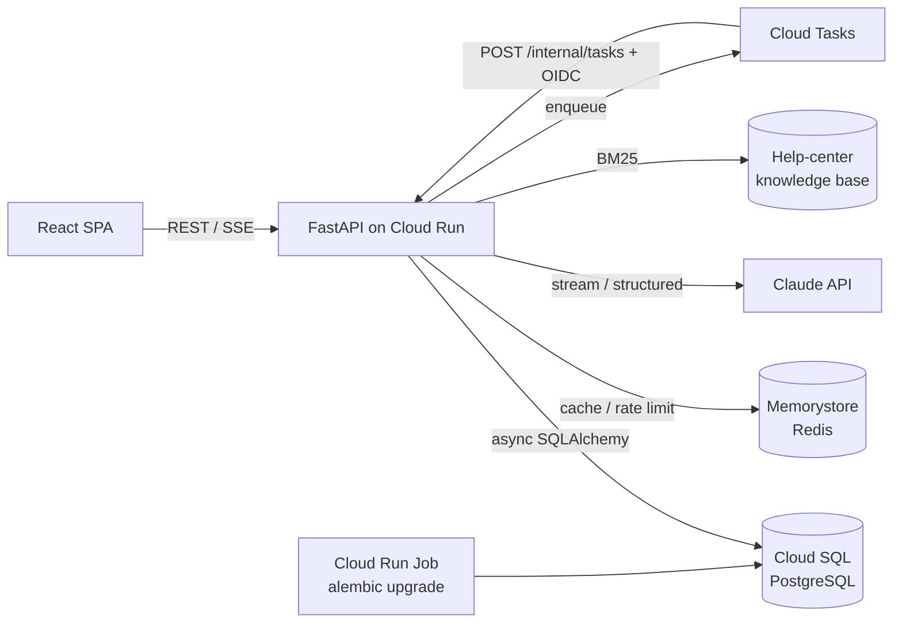

# Chatforge

로그인 없이 바로 쓰고, 가입하면 대화가 계정으로 이어지는 **AI 챗봇 SaaS 백엔드 + 웹 클라이언트**입니다.
LLM 서비스를 운영할 때 실제로 부딪히는 문제(익명 사용자, 토큰 비용 통제, 스트리밍 응답, RAG 검색, LLM 출력 검증, 비동기 작업, 무중단 스키마 변경)를 작게 재현하고 해결하는 데 초점을 맞췄습니다.

## 만든 배경

실무에서 AI 챗봇 서비스의 백엔드(FastAPI, GCP Cloud Run)를 개발하고 운영했습니다. 다만 그 코드는 회사 소유이고 내부 인프라 설정과 운영 정보가 포함되어 있어, 보안과 저작권 문제로 공개할 수 없습니다.

그래서 실무에서 직접 다뤘던 문제들을 회사 코드 없이 처음부터 다시 설계하고 구현했습니다. 비회원 대화를 회원 계정으로 이관하는 흐름, 토큰 사용량 제한, Redis 캐시와 장애 대응, RAG 검색 계층, LLM 출력 검증, 구조화 로깅, Cloud Run 배포가 여기에 해당합니다.

- 회사 저장소의 코드, 설정, 데이터는 사용하지 않았습니다.
- 짧은 기간에 재구현하면서 커밋을 기능 단위로 정리했습니다. 그래서 커밋 수가 적고 작성 시간이 몰려 있습니다.
- 실무에서 같은 문제를 어떻게 겪고 해결했는지는 면접에서 자세히 설명드릴 수 있습니다.

| 영역 | 사용 기술 |
|---|---|
| Backend | Python 3.12, FastAPI, SQLAlchemy 2 (async), Alembic, Pydantic v2 |
| Data | PostgreSQL, Redis |
| LLM | Anthropic Claude API (SSE 스트리밍, 구조화 출력), RAG(BM25), 테스트·로컬용 Fake provider |
| Frontend | React 18, TypeScript, Vite |
| Infra | Cloud Run, Cloud SQL, Memorystore, Cloud Tasks, Secret Manager, GitHub Actions |

## 주요 기능

- **게스트 → 회원 이관**: 익명으로 대화하다 가입·로그인하면 대화와 오늘 사용량이 한 트랜잭션으로 계정에 이관
- **토큰 쿼터**: 플랜별(게스트/무료/프로) 일일 토큰 한도 + 분당 요청 제한
- **스트리밍 응답**: Server-Sent Events로 토큰 단위 전송, 중단·오류 시 부분 응답 보존
- **비동기 작업**: 대화 제목 자동 생성을 Cloud Tasks로 분리 (로컬은 in-process)
- **장애 대응**: Redis 장애 시에도 쿼터는 DB 기준으로 계속 강제, 서킷 브레이커로 지연 차단
- **RAG**: 도움말 지식베이스를 검색해 출처 번호와 함께 답변, 라우터·검색 장애 시 검색 없이 답변
- **히스토리 캐시**: 대화 컨텍스트를 Redis에 캐시하되 메시지 순번으로 누락을 검출해 DB에서 재구성
- **추천 후속 질문**: 구조화 출력 + 검증으로 답변 아래 질문 칩 표시
- **관측성**: Cloud Logging JSON 로그, 요청·트레이스 ID 연동

## 아키텍처



## 설계 포인트

### 1. 게스트 → 회원 데이터 이관
[`app/services/claim.py`](backend/app/services/claim.py) · 테스트 [`test_claim.py`](backend/tests/test_claim.py)

- 대화(`conversations`)는 `user_id`와 `guest_id` 중 **정확히 하나**를 소유자로 가집니다. DB CHECK 제약으로 보장합니다.
- 가입·로그인 요청에 게스트 토큰을 함께 보내면 대화 소유권과 **오늘 사용량**을 같은 트랜잭션에서 옮깁니다. 사용량까지 옮기는 이유는 "새 게스트 생성 → 가입"으로 일일 한도를 초기화하는 우회를 막기 위해서입니다.
- 게스트 행을 `SELECT … FOR UPDATE`로 잠가 같은 토큰으로 동시에 로그인해도 한 번만 이관되고, 재시도해도 결과가 같습니다(멱등).
- 공용 기기에 남은 토큰처럼 이미 A에게 이관된 게스트는 B가 다시 가져갈 수 없습니다.
- 이관된 게스트 토큰은 `401 guest_claimed`로 응답하고, 클라이언트는 이 코드를 받으면 새 게스트 세션을 시작합니다.

### 2. 토큰 쿼터: DB가 진실, Redis는 캐시
[`app/services/quota.py`](backend/app/services/quota.py) · 테스트 [`test_resilience.py`](backend/tests/test_resilience.py)

- `usage_daily`(subject, day) 테이블이 기준값입니다. 어시스턴트 메시지 저장과 **같은 트랜잭션**에서 UPSERT하므로 저장된 메시지와 사용량이 어긋나지 않습니다.
- Redis는 cache-aside로만 씁니다. 쓰기 시에는 값을 증가시키지 않고 키를 무효화합니다. 무효화 직전에 읽은 오래된 값이 다시 캐시될 수 있는 경쟁이 남아 있어서 TTL을 5분으로 짧게 잡았습니다. 일일 한도라는 soft limit에서 허용할 수 있는 수준이라고 판단했습니다.
- **Redis 장애 시**
  - 쿼터: DB로 fallback합니다. 한도는 계속 강제됩니다.
  - 분당 rate limit: fail-open합니다. 가용성을 우선했습니다.
  - 서킷 브레이커: 처음에는 Redis가 죽으면 요청마다 연결 재시도를 기다려 **첫 바이트까지 8.4초**가 걸렸습니다. 실패 후 10초 동안 Redis를 건너뛰는 브레이커를 넣어 **0.27초**로 줄였습니다(로컬 측정).
- 게스트 생성 API는 IP당 시간당 생성 횟수를 제한합니다. 그렇지 않으면 게스트를 무한히 만들어 한도를 우회할 수 있습니다.

### 3. SSE 스트리밍
[`routers/conversations.py`](backend/app/routers/conversations.py) · [`frontend/src/sse.ts`](frontend/src/sse.ts)

- 쿼터·rate limit 검사는 **스트림을 열기 전에** 끝내고, 초과하면 일반 HTTP 429로 응답합니다. 스트림 도중에는 상태 코드를 바꿀 수 없기 때문입니다.
- 메시지 전송이 POST라서 `EventSource`를 쓸 수 없습니다. 그래서 `fetch` + `ReadableStream`으로 직접 파싱합니다. 네트워크 청크가 이벤트 중간이나 **한글 멀티바이트 문자 중간**에서 끊겨도 깨지지 않도록 `TextDecoder` 스트리밍 모드와 버퍼링을 사용합니다(단위 테스트 포함).
- LLM 오류가 나거나 사용자가 중지하면, 그때까지 생성된 부분 응답을 저장하고 추정 토큰을 과금합니다. 연결을 끊어서 과금을 피하는 우회를 막기 위해서입니다.
- LLM 호출은 `LLMProvider` 프로토콜 뒤에 있습니다. 실제 Claude API 대신 결정적인 `FakeProvider`를 끼울 수 있어서, API 키 없이도 로컬 실행과 테스트가 가능합니다.

### 4. 서버리스 환경의 비동기 처리
[`app/services/tasks.py`](backend/app/services/tasks.py) · [`routers/internal.py`](backend/app/routers/internal.py)

- Cloud Run은 응답을 보낸 뒤 CPU를 제한할 수 있습니다. 그래서 운영 환경에서는 `asyncio.create_task`에 기대지 않고 **Cloud Tasks**에 작업을 넣습니다.
- 콜백 엔드포인트는 Google이 서명한 **OIDC 토큰**의 audience와 서비스 계정을 검증합니다. 이 엔드포인트는 `TASK_BACKEND=cloudtasks`일 때만 마운트됩니다.
- Cloud Tasks는 at-least-once로 전달하므로 핸들러를 멱등하게 만들었습니다. 제목이 비어 있을 때만 채우기 때문에 중복 실행돼도 안전하고, 사용자가 바꾼 제목을 덮어쓰지도 않습니다.

### 5. 스키마 마이그레이션
[`migrations/versions/`](backend/migrations/versions)

- `0001`은 회원 전용 스키마이고, `0002`는 게스트를 도입하며 `user_id`를 nullable로 바꾸고 `guest_id`와 CHECK 제약을 추가합니다. 실제 서비스가 진화하는 순서 그대로 작성했습니다.
- `0003`은 메시지 순번(seq)을 **expand → backfill → contract** 순서로 도입합니다. 컬럼을 추가하고, 기존 메시지에 `ROW_NUMBER()`로 순번을 채운 뒤, NOT NULL과 유니크 제약을 겁니다. `0004`는 인용(citations) 컬럼을 추가합니다.
- 배포 시 **Cloud Run Job으로 마이그레이션을 먼저 실행**하고, 성공해야 새 리비전으로 트래픽을 넘깁니다. 인스턴스가 여러 대로 늘어나도 부팅 시 마이그레이션이 서로 경쟁하지 않습니다.
- CI에서는 Postgres에 `upgrade → alembic check(모델과 마이그레이션 간 차이 검출) → downgrade → upgrade`를 실행합니다.

### 6. RAG 검색 계층
[`app/services/rag.py`](backend/app/services/rag.py) · [`search.py`](backend/app/services/search.py) · 테스트 [`test_rag.py`](backend/tests/test_rag.py)

- **라우터**: 작은 LLM 호출이 구조화 출력으로 "검색이 필요한가"와 "앞 대화를 반영한 독립 검색 쿼리"를 만듭니다. 라우팅은 최적화일 뿐이므로 **8초 타임아웃이나 오류가 나면 검색 없이 답변**합니다. 라우터 장애가 채팅 장애로 번지지 않게 하기 위해서입니다.
- **하이브리드 검색**: 대화가 3턴 이상 이어지면 라우터가 검색 불필요로 판단해도 쿼리가 있으면 검색합니다. 깊어진 후속 질문일수록 근거가 필요한 경우가 많은데 라우터가 이를 과소평가하는 경향을 보완합니다.
- **검색**: 한국어는 형태소 분석기 없이 글자 bigram으로 색인합니다("한도"가 "한도를"에 매칭). 공통 bigram 하나로 잡담이 검색되는 문제("오늘 날씨" → "오늘의 한도")를 테스트로 발견해, **질의어 커버리지 하한**을 두어 해결했습니다. `SearchProvider` 프로토콜 뒤에 있어 Vertex AI Search 같은 관리형 검색으로 교체할 수 있습니다.
- **인용 보존 압축**: 출처가 예산보다 길면 LLM으로 압축하되, 요약에서 `[n]` 인용이 빠지거나 없는 번호를 인용하면 **요약을 버리고 원문 발췌로 대체**합니다. 요약 때문에 출처가 조용히 사라지는 일을 막기 위해서입니다.
- 라우팅·압축에 쓴 토큰도 답변과 함께 사용자 쿼터에 과금합니다. 인용은 메시지에 저장되어 대화를 다시 열어도 출처가 보입니다.

### 7. 히스토리 캐시와 정합성
[`app/services/history.py`](backend/app/services/history.py) · [`redis_guard.py`](backend/app/services/redis_guard.py) · 테스트 [`test_history_cache.py`](backend/tests/test_history_cache.py)

- 대화별 최근 메시지를 Redis 리스트에 캐시하고, 메시지 저장 시 `RPUSHX`로 이어 붙입니다. `RPUSHX`는 키가 있을 때만 추가하므로 만료된 키에 뒷부분만 담긴 리스트가 생기지 않습니다.
- 동시 요청이 오래된 DB 결과로 캐시를 다시 채우면 메시지 하나가 빠질 수 있습니다. 그래서 메시지마다 대화 내 **순번(seq)을 원자적으로 할당**하고, 캐시를 읽을 때 순번이 연속인지, 마지막 순번이 현재 개수와 같은지 검사합니다. 하나라도 어긋나면 DB에서 다시 구성합니다. 캐시는 없거나 오래될 수는 있어도, 틀린 컨텍스트를 모델에 주지는 않습니다.
- 대화 전체 삭제나 게스트 이관처럼 키를 패턴으로 지워야 할 때는 Redis 전체를 블로킹하는 `KEYS` 대신 **`SCAN` + `UNLINK`**를 씁니다.
- 서킷 브레이커를 `RedisGuard`로 분리해 쿼터, rate limit, 히스토리 캐시가 같은 장애 처리 경로를 공유합니다.

### 8. LLM 출력 검증
[`app/services/suggestions.py`](backend/app/services/suggestions.py) · 테스트 [`test_suggestions.py`](backend/tests/test_suggestions.py)

- 구조화 출력은 JSON 형태를 보장할 뿐 내용까지 보장하지는 않습니다. 추천 질문은 UI에 그대로 노출되므로 Pydantic validator에서 제어문자와 `<ctrlNN>` 같은 토큰 잔여물, 문자열에 섞인 JSON, 빈 값, 중복, 지나치게 긴 항목을 걸러냅니다.
- 타임아웃, 오류, 거부 응답일 때는 추천 없이 정상 응답만 보냅니다. 부가 기능의 실패가 답변 실패로 번지지 않게 하기 위해서입니다.

### 9. 관측성
[`app/observability.py`](backend/app/observability.py)

- Cloud Logging이 파싱하는 JSON 한 줄 로그를 씁니다. `severity`로 로그 레벨을, `logging.googleapis.com/trace`로 Cloud Trace를 연결합니다.
- 요청마다 `request_id`를 부여하고, 이 값을 contextvars로 SSE 스트림과 백그라운드 작업 로그까지 전파합니다. 응답을 버퍼링하지 않는 순수 ASGI 미들웨어라서 스트리밍을 방해하지 않습니다.
- RAG는 단계별 소요 시간(라우터, 검색)과 검색 결과 수를 구조화 필드로 남깁니다.

## 로컬 실행

**Docker가 있다면**

```bash
docker compose up --build          # Postgres + Redis + 마이그레이션 + API(:8000)
cd frontend && npm install && npm run dev   # http://localhost:5173
```

실제 Claude 응답을 받으려면 `LLM_PROVIDER=anthropic ANTHROPIC_API_KEY=... docker compose up`으로 실행하세요. 기본값은 입력을 그대로 돌려주는 fake 모델입니다.

**Docker 없이 (SQLite)**

```bash
cd backend
python -m venv .venv && source .venv/bin/activate   # Windows: .venv\Scripts\activate
pip install -e ".[dev]"
export DATABASE_URL="sqlite+aiosqlite:///./dev.db"
alembic upgrade head
uvicorn app.main:create_app --factory --reload
```

Redis가 없어도 서버는 동작합니다. 위의 장애 대응 경로가 그대로 쓰입니다.

## 테스트

```bash
cd backend && pytest -q        # 51개 · 기본 SQLite, TEST_DATABASE_URL을 지정하면 Postgres
cd frontend && npm test        # SSE 파서
```

테스트는 `create_app()` 팩토리에 fake Redis, fake LLM, 기록용 Task Queue를 주입해 외부 서비스 없이 실행됩니다. 주요 검증 항목은 다음과 같습니다.

- 게스트 이관: 멱등성, 다른 계정의 재이관 차단, 사용량 병합
- 쿼터와 rate limit
- 스트리밍 중 LLM 오류
- 소유자 간 대화 격리
- Redis 장애와 서킷 브레이커
- Cloud Tasks 콜백 인증과 중복 전달
- RAG: 검색 정확도, 라우터 타임아웃·오류 fallback, 하이브리드 검색, 인용이 빠진 요약 폐기
- 히스토리 캐시: 캐시 적중, 누락 검출 후 재구성, 만료 fallback, 동시 메시지 순번, SCAN 삭제
- 추천 질문: 모델 출력 정제, 타임아웃·오류·거부 시 fallback

## 배포 (GCP)

```bash
PROJECT_ID=... ./deploy/setup-gcp.sh                               # 최초 1회: SQL, Redis, Tasks, IAM, Secrets
PROJECT_ID=... FRONTEND_ORIGIN=https://... ./deploy/deploy.sh      # 빌드 → 마이그레이션 Job → Cloud Run 배포
```

비밀값은 저장소나 환경변수 파일에 두지 않고 Secret Manager에서 주입합니다.

## 디렉터리 구조

```
backend/
  app/
    main.py            # 앱 팩토리, lifespan(DB/Redis/LLM/큐 생성)
    models.py          # SQLAlchemy 모델
    deps.py            # 인증 → Principal(user | guest)
    routers/           # auth, conversations(SSE), usage, internal(Cloud Tasks)
    services/          # llm, rag, search, history, quota, claim, suggestions, tasks
    observability.py   # JSON 로그, 요청·트레이스 ID
  knowledge/           # RAG용 도움말 문서 (마크다운)
  migrations/          # Alembic (async)
  tests/
frontend/src/
  api.ts, sse.ts       # API 클라이언트, 스트리밍 파서
  components/          # Sidebar, ChatPanel, AuthDialog
deploy/                # GCP 셋업·배포 스크립트
```

## 한계와 다음 단계

- Access token만 있고 refresh token과 토큰 폐기(revocation)는 없습니다.
- 쿼터는 요청 전에 검사하는 soft limit이라 마지막 한 요청은 한도를 넘을 수 있습니다. 엄격하게 하려면 `max_tokens` 기준으로 예약했다가 정산하는 방식이 필요합니다.
- 클라이언트 연결이 끊긴 응답의 토큰은 문자 수 기반으로 추정합니다.

## AI 코딩 도구 활용

이 프로젝트는 Claude Code와 함께 개발했습니다. 저장소 규칙과 명령어는 [`CLAUDE.md`](CLAUDE.md)에 정리해 에이전트와 사람이 같은 기준으로 작업하도록 했습니다.
