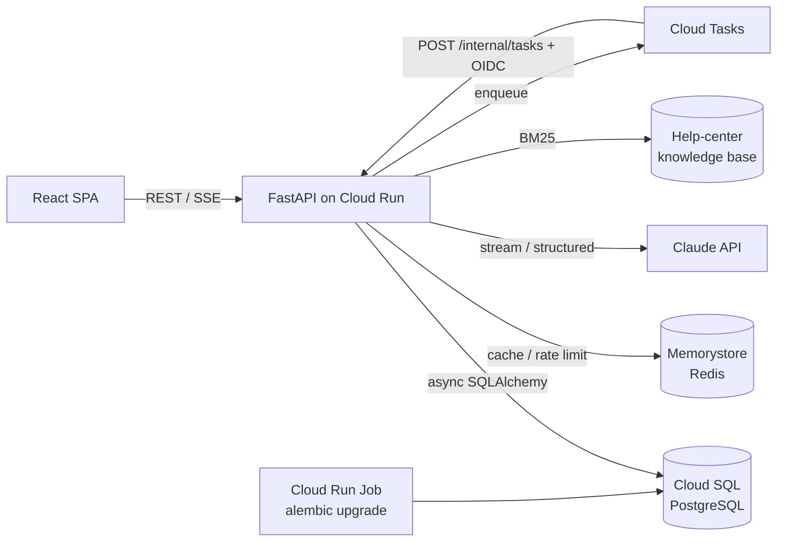

# Chatforge

로그인 없이 바로 쓰고, 가입하면 대화가 계정으로 이어지는 **AI 챗봇 SaaS 백엔드 + 웹 클라이언트**입니다.
LLM 서비스를 운영할 때 실제로 부딪히는 문제(익명 사용자, 토큰 비용 통제, 스트리밍 응답, RAG 검색, LLM 출력 검증, 비동기 작업, 무중단 스키마 변경)를 작게 재현하고 해결하는 데 초점을 맞췄습니다.

## 만든 배경

실무에서 AI 챗봇 서비스의 백엔드(FastAPI, GCP Cloud Run)를 개발하고 운영했습니다. 다만 그 코드는 회사 소유이고 내부 인프라 설정과 운영 정보가 포함되어 있어, 보안과 저작권 문제로 공개할 수 없습니다.

그래서 실무에서 직접 다뤘던 문제들을 회사 코드 없이 처음부터 다시 설계하고 구현했습니다. 비회원 대화를 회원 계정으로 이관하는 흐름, 토큰 사용량 제한, Redis 캐시와 장애 대응, RAG 검색 계층, LLM 출력 검증, 구조화 로깅, Cloud Run 배포가 여기에 해당합니다.

- 회사 저장소의 코드, 설정, 데이터는 사용하지 않았습니다.
- 짧은 기간에 재구현하면서 커밋을 기능 단위로 정리했습니다. 그래서 커밋 수가 적고 작성 시간이 몰려 있습니다.
- 실무에서 실제로 겪은 문제와 결과 수치는 [실무 사례 → chatforge 재현](#실무-사례--chatforge-재현)에 정리했습니다.

| 영역 | 사용 기술 |
|---|---|
| Backend | Python 3.12, FastAPI, SQLAlchemy 2 (async), Alembic, Pydantic v2 |
| Data | PostgreSQL, Redis |
| LLM | LangGraph 에이전트, LangChain(Claude · 로컬 Qwen3 8B via Ollama), 구조화 출력, RAG(BM25), 테스트용 fake 모델 |
| Frontend | React 18, TypeScript, Vite |
| Infra | Cloud Run, Cloud SQL, Memorystore, Cloud Tasks, Secret Manager, GitHub Actions |

## 주요 기능

- **게스트 → 회원 이관**: 익명으로 대화하다 가입·로그인하면 대화와 오늘 사용량이 한 트랜잭션으로 계정에 이관
- **토큰 쿼터**: 플랜별(게스트/무료/프로) 일일 토큰 한도 + 분당 요청 제한. 출력·캐시 토큰은 가격 비율로 가중해 과금
- **프롬프트 캐싱**: 대화 앞부분이 턴마다 같도록 프롬프트를 구성해 이전 대화를 캐시에서 읽음
- **스트리밍 응답**: Server-Sent Events로 토큰 단위 전송, 중단·오류 시 부분 응답 보존
- **비동기 작업**: 대화 제목 자동 생성을 Cloud Tasks로 분리 (로컬은 in-process)
- **장애 대응**: Redis 장애 시에도 쿼터는 DB 기준으로 계속 강제, 서킷 브레이커로 지연 차단
- **RAG**: 도움말 문서와 사용자 본인의 지난 대화를 병렬로 검색하고 계정 현황까지 출처 번호와 함께 답변, 소스별 장애 격리
- **긴 대화 요약**: 오래된 턴을 백그라운드에서 요약해 컨텍스트를 줄이되, 진행 중인 질문과 답은 원문 유지
- **히스토리 캐시**: 대화 컨텍스트를 Redis에 캐시하되 메시지 순번으로 누락을 검출해 DB에서 재구성
- **추천 후속 질문**: 구조화 출력 + 검증으로 답변 아래 질문 칩 표시
- **관측성**: Cloud Logging JSON 로그, 요청·트레이스 ID 연동

## 아키텍처



## 설계 포인트

### 1. 게스트 → 회원 데이터 이관
[`app/services/claim.py`](backend/app/services/claim.py) · 테스트 [`test_claim.py`](backend/tests/test_claim.py)

- 대화(`conversations`)는 `user_id`와 `guest_id` 중 **정확히 하나**를 소유자로 가집니다. DB CHECK 제약으로 보장합니다.
- 가입·로그인 요청에 게스트 토큰을 함께 보내면 대화 소유권과 **오늘 사용량**을 같은 트랜잭션에서 옮깁니다. 사용량까지 옮기는 이유는 "새 게스트 생성 → 가입"으로 일일 한도를 초기화하는 우회를 막기 위해서입니다.
- 게스트 행을 `SELECT … FOR UPDATE`로 잠가 같은 토큰으로 동시에 로그인해도 한 번만 이관되고, 재시도해도 결과가 같습니다(멱등).
- 공용 기기에 남은 토큰처럼 이미 A에게 이관된 게스트는 B가 다시 가져갈 수 없습니다.
- 이관된 게스트 토큰은 `401 guest_claimed`로 응답하고, 클라이언트는 이 코드를 받으면 새 게스트 세션을 시작합니다.

### 2. 토큰 쿼터: DB가 진실, Redis는 캐시
[`app/services/quota.py`](backend/app/services/quota.py) · 테스트 [`test_resilience.py`](backend/tests/test_resilience.py)

- `usage_daily`(subject, day) 테이블이 기준값입니다. 어시스턴트 메시지 저장과 **같은 트랜잭션**에서 UPSERT하므로 저장된 메시지와 사용량이 어긋나지 않습니다.
- Redis는 cache-aside로만 씁니다. 쓰기 시에는 값을 증가시키지 않고 키를 무효화합니다. 무효화 직전에 읽은 오래된 값이 다시 캐시될 수 있는 경쟁이 남아 있어서 TTL을 5분으로 짧게 잡았습니다. 일일 한도라는 soft limit에서 허용할 수 있는 수준이라고 판단했습니다.
- **Redis 장애 시**
  - 쿼터: DB로 fallback합니다. 한도는 계속 강제됩니다.
  - 분당 rate limit: fail-open합니다. 가용성을 우선했습니다.
  - 서킷 브레이커: 처음에는 Redis가 죽으면 요청마다 연결 재시도를 기다려 **첫 바이트까지 8.4초**가 걸렸습니다. 실패 후 10초 동안 Redis를 건너뛰는 브레이커를 넣어 **0.27초**로 줄였습니다(로컬 측정).
- 게스트 생성 API는 IP당 시간당 생성 횟수를 제한합니다. 그렇지 않으면 게스트를 무한히 만들어 한도를 우회할 수 있습니다.

### 3. SSE 스트리밍
[`routers/conversations.py`](backend/app/routers/conversations.py) · [`frontend/src/sse.ts`](frontend/src/sse.ts)

- 쿼터·rate limit 검사는 **스트림을 열기 전에** 끝내고, 초과하면 일반 HTTP 429로 응답합니다. 스트림 도중에는 상태 코드를 바꿀 수 없기 때문입니다.
- 메시지 전송이 POST라서 `EventSource`를 쓸 수 없습니다. 그래서 `fetch` + `ReadableStream`으로 직접 파싱합니다. 네트워크 청크가 이벤트 중간이나 **한글 멀티바이트 문자 중간**에서 끊겨도 깨지지 않도록 `TextDecoder` 스트리밍 모드와 버퍼링을 사용합니다(단위 테스트 포함).
- LLM 오류가 나거나 사용자가 중지하면, 사용자에게 보인 부분만 답변으로 저장하고 모델이 실제로 쓴 분량을 추정해 과금합니다. 에이전트가 붙잡아 둔(holdback) 텍스트도 과금 대상입니다. 연결을 끊어서 과금을 피하는 우회를 막기 위해서입니다.
- 아무것도 보이기 전에 끝난 턴은 user 메시지까지 **되돌립니다**. 남겨 두면 다음 질문이 첫 메시지로 인정되지 않아 대화 제목이 영영 생기지 않고, 같은 질문이 두 번 쌓입니다. 화면도 같은 규칙으로 말풍선을 지우고 질문을 입력창에 되돌립니다.
- **턴 단위 입장 제어**: 한 대화에서는 한 번에 한 턴만 스트리밍합니다(Redis `SET NX` 락, 동시 요청은 409). 그렇지 않으면 `user, user, assistant, assistant` 순서가 됩니다. 사용자별 동시 스트림 수에도 상한(기본 2)을 둡니다. 쿼터는 턴 시작 때 확인하고 끝날 때 차감하므로, 병렬 턴으로 한도를 넘는 폭을 이 상한이 묶습니다. Redis가 없으면 둘 다 fail-open하고, 원자적인 순번 할당이 순서를 지킵니다. 동시 스트림 수는 단순 카운터가 아니라 턴별 시작 시각을 담은 sorted set으로 셉니다. 그래서 크래시한 인스턴스의 턴은 사용자가 계속 대화하는 중에도 TTL이 지나면 빠집니다.
- **정리가 빠지지 않게**: Starlette는 헤더를 보낸 뒤 본문 제너레이터를 실행합니다. 그래서 헤더 전송이 실패하면 제너레이터가 한 번도 시작되지 않고 `finally`도 돌지 않습니다. 응답 객체(`TurnResponse`)가 이 경우를 직접 정리합니다. 취소된 요청의 저장 작업은 서버가 종료될 때 DB를 닫기 전에 기다립니다.
- 답변은 LangChain 채팅 모델(`build_chat_model`)이, 보조 호출은 `LLMProvider`가 맡습니다. 둘 다 결정적인 fake로 바꿀 수 있어서, API 키 없이도 로컬 실행과 테스트가 가능합니다.

### 4. 서버리스 환경의 비동기 처리
[`app/services/tasks.py`](backend/app/services/tasks.py) · [`routers/internal.py`](backend/app/routers/internal.py)

- Cloud Run은 응답을 보낸 뒤 CPU를 제한할 수 있습니다. 그래서 운영 환경에서는 `asyncio.create_task`에 기대지 않고 **Cloud Tasks**에 작업을 넣습니다.
- 콜백 엔드포인트는 Google이 서명한 **OIDC 토큰**의 audience와 서비스 계정을 검증합니다. 이 엔드포인트는 `TASK_BACKEND=cloudtasks`일 때만 마운트됩니다.
- Cloud Tasks는 at-least-once로 전달하므로 핸들러를 멱등하게 만들었습니다. 제목이 비어 있을 때만 채우기 때문에 중복 실행돼도 안전하고, 사용자가 바꾼 제목을 덮어쓰지도 않습니다.

### 5. 스키마 마이그레이션
[`migrations/versions/`](backend/migrations/versions)

- `0001`은 회원 전용 스키마이고, `0002`는 게스트를 도입하며 `user_id`를 nullable로 바꾸고 `guest_id`와 CHECK 제약을 추가합니다. 실제 서비스가 진화하는 순서 그대로 작성했습니다.
- `0003`은 메시지 순번(seq)을 **expand → backfill → contract** 순서로 도입합니다. 컬럼을 추가하고, 기존 메시지에 `ROW_NUMBER()`로 순번을 채운 뒤, NOT NULL과 유니크 제약을 겁니다. `0004`는 인용(citations) 컬럼을 추가합니다.
- 배포 시 **Cloud Run Job으로 마이그레이션을 먼저 실행**하고, 성공해야 새 리비전으로 트래픽을 넘깁니다. 인스턴스가 여러 대로 늘어나도 부팅 시 마이그레이션이 서로 경쟁하지 않습니다.
- CI에서는 Postgres에 `upgrade → alembic check(모델과 마이그레이션 간 차이 검출) → downgrade → upgrade`를 실행합니다.

### 6. RAG 검색 계층
[`app/services/rag.py`](backend/app/services/rag.py) · [`search.py`](backend/app/services/search.py) · 테스트 [`test_rag.py`](backend/tests/test_rag.py)

- **라우터**: 작은 LLM 호출이 구조화 출력으로 "검색이 필요한가"와 "앞 대화를 반영한 독립 검색 쿼리"를 만듭니다. 라우팅은 최적화일 뿐이므로 **8초 타임아웃이나 오류가 나면 검색 없이 답변**합니다. 라우터 장애가 채팅 장애로 번지지 않게 하기 위해서입니다.
- **하이브리드 검색**: 대화가 3턴 이상 이어지면 라우터가 검색 불필요로 판단해도 쿼리가 있으면 검색합니다. 깊어진 후속 질문일수록 근거가 필요한 경우가 많은데 라우터가 이를 과소평가하는 경향을 보완합니다.
- **병렬 다중 소스**: 도움말 문서 검색과 **사용자 본인의 지난 대화 검색**("지난번에 정한 숙소 어디였지?")을 `asyncio.gather`로 동시에 실행합니다. 대기 시간은 두 검색 시간의 합이 아니라 더 느린 쪽 하나의 시간입니다. 소스마다 타임아웃과 예외를 격리해서 도움말 검색이 죽거나 느려도 지난 대화로 답하고, 결과는 완료 순서가 아니라 소스 순서로 병합해 출처 번호가 매번 같습니다. 실무에서 병렬 분기는 실행됐는데 한쪽 결과만 답변 모델에 전달되던 버그가 있어서, 모든 소스의 결과가 근거에 들어가는지 테스트로 고정했습니다.
- **지난 대화 검색**: 소유자의 최근 대화 20개에서 현재 대화와 삭제된 대화를 빼고, 요청마다 BM25로 순위를 매깁니다. 소유자 필터는 대화 API와 같은 `_owned_by`를 써서 다른 사용자의 대화가 후보에 들어갈 수 없습니다. 이 규모에서는 색인을 만드는 데 1ms도 걸리지 않습니다. 규모가 커지면 같은 함수 뒤에서 전문 검색이나 벡터 색인으로 바꾸면 됩니다.
- **계정 현황 출처**: "오늘 남은 토큰 한도는?"에는 도움말(한도 규칙)과 사용자 본인의 사용량이 함께 필요합니다. 라우터가 `needs_account`를 따로 판단하면 요금제와 오늘 사용량을 `[1] 내 계정 현황`으로 인용합니다. 값은 요청 직전에 검사한 쿼터를 그대로 재사용합니다. 압축 대상에서 빼서 요약이 사용자 수치를 바꾸거나 빠뜨리지 못하게 했고, 인용이 메시지와 함께 저장되므로 기준 시각을 함께 적습니다.
- **검색**: 한국어는 형태소 분석기 없이 글자 bigram으로 색인합니다("한도"가 "한도를"에 매칭). 공통 bigram 하나로 잡담이 검색되는 문제("오늘 날씨" → "오늘의 한도")를 테스트로 발견해, **질의어 커버리지 하한**을 두어 해결했습니다. `SearchProvider` 프로토콜 뒤에 있어 Vertex AI Search 같은 관리형 검색으로 교체할 수 있습니다.
- **인용 보존 압축**: 검색 결과가 예산보다 길면 LLM으로 압축하되, 요약에서 `[n]` 인용이 빠지거나 없는 번호를 인용하면 **요약을 버리고 원문 발췌로 대체**합니다. 요약 때문에 출처가 조용히 사라지는 일을 막기 위해서입니다.
- 라우팅·압축에 쓴 토큰도 답변과 함께 사용자 쿼터에 과금합니다. 인용은 메시지에 저장되어 대화를 다시 열어도 출처가 보입니다.

### 7. 히스토리 캐시와 정합성
[`app/services/history.py`](backend/app/services/history.py) · [`redis_guard.py`](backend/app/services/redis_guard.py) · 테스트 [`test_history_cache.py`](backend/tests/test_history_cache.py)

- 대화별 최근 메시지를 Redis 리스트에 캐시하고, 메시지 저장 시 `RPUSHX`로 이어 붙입니다. `RPUSHX`는 키가 있을 때만 추가하므로 만료된 키에 뒷부분만 담긴 리스트가 생기지 않습니다.
- 동시 요청이 오래된 DB 결과로 캐시를 다시 채우면 메시지 하나가 빠질 수 있습니다. 그래서 메시지마다 대화 내 **순번(seq)을 원자적으로 할당**하고, 캐시를 읽을 때 순번이 연속인지, 마지막 순번이 현재 개수와 같은지 검사합니다. 하나라도 어긋나면 DB에서 다시 구성합니다. 캐시는 없거나 오래될 수는 있어도, 틀린 컨텍스트를 모델에 주지는 않습니다.
- 대화 전체 삭제나 게스트 이관처럼 키를 패턴으로 지워야 할 때는 Redis 전체를 블로킹하는 `KEYS` 대신 **`SCAN` + `UNLINK`**를 씁니다.
- 서킷 브레이커를 `RedisGuard`로 분리해 쿼터, rate limit, 히스토리 캐시가 같은 장애 처리 경로를 공유합니다.

### 8. LLM 출력 검증
[`app/services/suggestions.py`](backend/app/services/suggestions.py) · 테스트 [`test_suggestions.py`](backend/tests/test_suggestions.py)

- 구조화 출력은 JSON 형태를 보장할 뿐 내용까지 보장하지는 않습니다. 추천 질문은 UI에 그대로 노출되므로 Pydantic validator에서 제어문자와 `<ctrlNN>` 같은 토큰 잔여물, 문자열에 섞인 JSON, 빈 값, 중복, 지나치게 긴 항목을 걸러냅니다.
- 타임아웃, 오류, 거부 응답일 때는 추천 없이 정상 응답만 보냅니다. 부가 기능의 실패가 답변 실패로 번지지 않게 하기 위해서입니다.

### 9. 토큰 비용: 가중 과금과 프롬프트 캐싱
[`app/services/llm.py`](backend/app/services/llm.py) · 테스트 [`test_billing.py`](backend/tests/test_billing.py) · [`test_prompt_cache.py`](backend/tests/test_prompt_cache.py)

- **가중 과금**: 쿼터가 입력과 출력 토큰을 같은 값으로 세면 실제 비용과 맞지 않습니다. 그래서 쿼터 단위를 "입력 토큰 환산값"으로 정하고 출력 5배, 캐시 쓰기 1.25배, 캐시 읽기 0.05배를 곱합니다(`claude-opus-5-5` 가격 기준, `TOKEN_WEIGHT_*`로 조정). 소수점은 올림하므로 전부 캐시된 응답도 최소 1토큰은 과금됩니다. 캐시가 적중하면 사용자 한도도 덜 줄어듭니다.
- **고정 system 프롬프트**: 캐싱은 prefix가 일치해야 동작합니다. 처음에는 RAG 출처를 system 프롬프트 뒤에 붙였는데, 출처는 매 턴 달라지므로 그 뒤에 오는 대화 전체가 매번 캐시를 놓치는 구조였습니다. 출처를 **현재 user 턴의 `context`**로 옮기고 저장하거나 다시 보내지 않게 해서, 다음 요청의 앞부분이 이전 요청과 바이트 단위로 같게 만들었습니다.
- **breakpoint 위치**: system 끝과 **현재 턴 직전 턴**에 둡니다. 현재 턴에 두면 다음 요청에서 다시 쓰이지 않는 출처까지 캐시에 쓰느라 1.25배 비용만 내게 됩니다. 직전 턴에 두면 다음 요청이 한 턴 뒤에 새로 캐시를 쓰고, lookback으로 이번 캐시를 찾아 이전 답변까지 캐시에서 읽습니다.
- **검증**: `ChatAnthropic`이 우리 메시지로 만드는 실제 요청 본문을 검사합니다. system과 직전 턴의 breakpoint, 현재 턴 출처가 다음 요청에 다시 실리지 않는지, 답변 모델의 서버측 refusal fallback 설정을 확인합니다. 응답 `usage`의 캐시 토큰이 과금까지 전달되는지는 `usage_from_message` 테스트로 확인합니다. API 키도 네트워크도 필요 없습니다.

### 10. 긴 대화 요약
[`app/services/summary.py`](backend/app/services/summary.py) · 테스트 [`test_summary.py`](backend/tests/test_summary.py)

- **문제**: 최근 N개 메시지만 보내면 긴 대화에서 앞부분을 잊습니다. 또 창이 매 턴 한 칸씩 밀리면서 프롬프트 맨 앞이 계속 바뀌어 프롬프트 캐싱도 깨집니다.
- **방식**: 요약 경계 뒤에 쌓인 메시지가 일정 개수나 토큰을 넘으면 Cloud Tasks로 요약 작업을 넣습니다. 작업은 오래된 메시지를 이전 요약과 합쳐 `conversations.summary`에 저장하고 경계(`summarized_through_seq`)를 옮깁니다. 요청에는 요약을 system 프롬프트에 넣고 경계 이후 메시지만 보냅니다. 다음 요약 전까지 프롬프트 앞부분이 고정되므로 캐시도 계속 적중합니다.
- **경계 규칙**: 실무에서 어시스턴트가 사용자 의도를 되묻는 중에 요약이 실행되어, 원래 질문이 요약에 묻히고 사용자의 답만 남은 버그가 있었습니다. 그래서 경계는 항상 user 메시지 바로 앞에 두고 **최근 N개 user 턴은 원문 그대로** 둡니다. 진행 중인 질문과 답은 요약 대상에 들어가지 않습니다. 이 버그를 재현하는 테스트를 넣었습니다.
- **정합성**: 요약과 경계는 같은 행에 있고, "작업을 시작할 때의 경계와 같을 때만" 한 번의 UPDATE로 함께 바뀝니다. Cloud Tasks가 같은 작업을 겹쳐 전달해도 한 결과만 반영됩니다. 읽는 쪽은 항상 짝이 맞는 요약과 경계를 받으므로 메시지가 빠지거나 두 번 들어가지 않습니다.
- **실패 시**: 요약 호출 실패, 타임아웃, 길이 초과면 아무것도 바꾸지 않고 기존처럼 전체 창을 보냅니다. 토큰은 실제로 반영된 요약만 대화 소유자에게 과금합니다. 재시도나 경쟁에서 진 실행 비용은 서비스가 부담합니다.

### 11. LangGraph 에이전트 (기본 경로)
[`app/agent/graph.py`](backend/app/agent/graph.py) · [`tools.py`](backend/app/agent/tools.py) · 테스트 [`test_agent.py`](backend/tests/test_agent.py)

실무에서 설계한 LangGraph 에이전트 구조를 설계만 가져와 새로 구현했습니다(회사 코드는 사용하지 않았습니다). 모든 대화가 이 그래프를 거칩니다. 도움말 문서가 없으면 도움말 검색만 빠지고 나머지는 그대로 동작합니다.

```
router ─▶ master_router ─┬─▶ clarify ─▶ END
                         ├─▶ coordinator ─▶ agent
                         └─▶ agent ⇄ tools ─▶ END
```

- **router → master_router**: 구조화 출력 한 번으로 이번 턴에 필요한 것(도움말, 본인 계정, 지난 대화)을 판단하거나, 질문이 모호해서 되물어야 하는지 판단합니다. 조건부 엣지가 세 갈래로 보냅니다.
- **clarify**: 라우터가 만든 되묻는 질문이 곧 답입니다. 모델을 다시 부르지 않고, 이 턴에서는 추천 질문과 요약을 실행하지 않습니다. 요약하면 사용자가 곧 답할 질문이 요약에 묻히기 때문입니다(실무 사례 5).
- **coordinator**: 라우터가 요청한 소스를 병렬로 조회해 현재 턴에 근거로 붙입니다(설계 포인트 6).
- **agent ⇄ tools (ReAct)**: 미리 조회한 근거로 부족하면 모델이 도구를 호출합니다. 한 메시지의 여러 도구 호출은 병렬로 실행하고, 출처 번호는 앞선 출처에 이어서 매깁니다.
- **라우터가 실패하면**: 검색 없이 답하지 않고 agent에게 도구 선택을 맡깁니다. 라우팅은 최적화일 뿐이고, 에이전트는 스스로 판단할 수 있기 때문입니다.
- **실패 처리 (실무 사례 3)**: 형식이 깨진 도구 호출은 **도구를 뺀 채** 1회 재시도합니다. 도구를 붙인 채 다시 물으면 같은 잘못된 호출을 반복했기 때문입니다. 도구 라운드는 상한(`AGENT_MAX_TOOL_ROUNDS`)이 있고, 닿으면 도구 없이 답하게 합니다. 도구 실패나 인자 오류는 턴을 끝내지 않고 모델에게 에러로 돌려줍니다. LangChain은 잘린 인자를 `{}`로 살려 "정상 호출"로 만들기도 해서, 인자 검증은 도구 쪽에서 합니다.
- **SSE 계약 유지**: `messages` 스트림에서 agent 노드의 AI 청크만 `delta`로 내보냅니다. 라우터의 모델 호출과, 노드가 다시 써 넣은 사용자 메시지는 걸러냅니다. 과금은 router와 모든 agent 라운드의 토큰을 합산하고, 파싱에 실패한 라우터 호출의 토큰도 포함합니다.
- **서두 문제**: 도구를 호출하는 라운드에서 모델이 "찾아볼게요" 같은 서두를 쓰면, 그대로 흘려보낼 경우 최종 답변 앞에 붙어 버립니다. 그래서 라운드마다 텍스트를 잠깐 붙잡아 둡니다. 도구 호출이 나오면 버리고, 일정 길이(`HOLDBACK_CHARS`)를 넘도록 도구 호출이 없으면 답변으로 보고 흘려보냅니다. 저장하는 답은 그래프가 확정한 최종 `answer`입니다. 이 판단은 순수 객체 [`AgentStream`](backend/app/agent/stream.py)에 있어서 단위 테스트로 검증합니다.
- **비용·부하 상한**: 도구 라운드 수와 라운드당 도구 호출 수(기본 3, 4)에 상한이 있습니다. "키워드 50개로 각각 검색해줘" 같은 요청이 지난 대화 검색 50건을 동시에 일으키지 못하게 하기 위해서입니다. 모든 agent 모델 호출에는 타임아웃이 있습니다.
- **프롬프트 인젝션 방어**: 도구 결과(도움말 문서, 사용자의 지난 메시지)는 `<sources>`로 감싸고 "지시가 아니라 자료"라고 명시합니다. 도구에는 사용자 ID 같은 인자가 없고, 소유자 필터는 요청 시점에 고정됩니다. 그래서 인젝션으로도 다른 사용자의 데이터에는 닿을 수 없습니다.
- **프롬프트 캐싱 유지**: Claude로 돌릴 때도 system과 직전 턴에 캐시 breakpoint를 둡니다. 라우터 실패 안내는 system이 아니라 현재 턴에 붙여, 캐시된 앞부분을 바꾸지 않습니다.
- **모델**: LangChain 채팅 모델 계층(`build_chat_model`)으로 provider를 고릅니다. 로컬은 도구 호출을 지원하는 Qwen3 8B(Ollama, `reasoning=False`)를 씁니다. 같은 모델이 `LangChainProvider`를 통해 라우팅·압축·추천 질문·요약도 맡습니다.

### 12. 관측성
[`app/observability.py`](backend/app/observability.py)

- Cloud Logging이 파싱하는 JSON 한 줄 로그를 씁니다. `severity`로 로그 레벨을, `logging.googleapis.com/trace`로 Cloud Trace를 연결합니다.
- 요청마다 `request_id`를 부여하고, 이 값을 contextvars로 SSE 스트림과 백그라운드 작업 로그까지 전파합니다. 응답을 버퍼링하지 않는 순수 ASGI 미들웨어라서 스트리밍을 방해하지 않습니다.
- 에이전트 router는 판단 결과(라우팅 성공 여부, 되묻기, 소스 계획)와 소요 시간을, RAG는 검색 소스별 결과 수·소요 시간·실패 원인(`timeout`, 예외 이름)을 구조화 필드로 남깁니다. 실패한 소스는 traceback과 함께 경고 로그를 남깁니다.

## 실무 사례 → chatforge 재현

실무(헬스케어 AI 챗봇, 개발자 3명 + 대표)에서 실제로 겪은 문제입니다. 날짜는 당시 저장소의 커밋 기록 기준이고, 팀원이 한 작업과 제가 한 작업을 나눠 적었습니다. 회사 코드는 옮기지 않았고, 같은 문제를 chatforge에서 다시 설계해 테스트로 고정했습니다.

### 1. 응답 40초~1분 30초를 병렬 조회로 15~45초로 단축

- **증상**: 이전 구조(Bubble.io 기반)에서는 답변까지 40초~1분 30초가 걸렸습니다. GA에서 응답 지연과 이탈률이 함께 움직이는 것을 확인했습니다.
- **원인**: 논문·약품·웹 검색과 사용자 의료기록 조회(진료·약국·검진·이전 대화)가 차례로 실행되어, 대기 시간이 모든 조회 시간의 합이었습니다.
- **해결**
  - 제 작업: 검색 계층과 의료기록 조회를 동시에 실행하는 coordinator 노드 작성(2025-11-25), 의료기록 결과 파서 병렬화(2026-01-13), 검색 계층 병렬 처리 수정(2026-01-15)
  - 팀원 작업: 병렬 노드에 LangSmith 트레이싱 추가(2025-11-26)
- **결과**: 빠르면 15초 이내, 최대 45초(목표 20초). 대화가 길어지거나 희귀 질환 질문일 때 느려집니다.
- **chatforge**: [`retrieval.py`](backend/app/services/retrieval.py)는 도움말 검색과 지난 대화 검색을 병렬로 실행하고 소스별로 장애를 격리합니다. 테스트: [`test_retrieval.py`](backend/tests/test_retrieval.py), [`test_personal_context.py`](backend/tests/test_personal_context.py)

### 2. 개인 의료기록이 답변에 반영되지 않던 RAG 설정 오류

- **증상**: 사용자가 연동한 진단·복용 약 정보가 있는데도, 답변이 그 정보를 반영하지 않았습니다. 개인 기록을 근거로 답하는 것이 서비스의 핵심 기능이었습니다.
- **원인을 찾은 과정**: LangSmith 트레이스로 해당 요청을 따라가 보니 개인 의료기록 검색 결과가 0건이었습니다. 모델은 사용자의 진단과 복용 약을 모른 채 답하고 있었습니다. 원인은 RAG 검색 설정이 개인 의료 연동 데이터를 찾지 못하게 잘못 구성된 것이었습니다.
- **해결(제 작업)**: 입사 초기에 검색 설정을 반복 테스트하며 바로잡아, 개인 의료기록이 답변 근거로 들어가게 했습니다. 이 수정은 커밋 기록으로 날짜를 특정하지 못해 날짜를 적지 않았습니다.
- **결과**: 개인 기록을 반영한 답변이 정상화됐습니다. 이후 "근거가 0건이면 로그에 드러나야 한다"를 원칙으로 삼았습니다.
- **chatforge**: RAG가 소스별 결과 수를 구조화 로그로 남깁니다(설계 포인트 11). 개인 데이터가 실제로 근거에 들어가는지 HTTP 테스트로 검사합니다: [`test_account_facts_and_help_articles_are_both_cited`, `test_earlier_conversations_are_searched`](backend/tests/test_personal_context.py)

### 3. Gemini `MALFORMED_FUNCTION_CALL`과 끝나지 않는 응답

- **증상**: 추천 질문 버튼 같은 도구 호출에서 Gemini가 `MALFORMED_FUNCTION_CALL`로 끝나는 경우가 있었고, 재시도 경로에서는 응답이 끝나지 않고 계속 생성됐습니다.
- **원인을 찾은 과정**: 재시도 시 도구가 바인딩된 agent를 다시 호출하고 있어서, 모델이 재시도 지시를 무시하고 같은 도구를 또 호출했습니다. 도구 입력 스키마가 중첩 Pydantic 모델이라 생성 실패 확률 자체도 높았습니다.
- **해결**
  - 팀원 작업: fallback의 무한 생성 수정(2025-12-09)
  - 제 작업
    - 도구 호출 실패를 줄이는 프롬프트 수정(2025-12-11)
    - 재시도 때 도구 없이 LLM을 직접 호출해 텍스트 답변만 받도록 변경(2025-12-23, PR #48)
    - 도구 스키마를 inline JSON Schema로 단순화하고 `tool_call_id` 매칭 개선(2026-01-07)
    - 추천 질문의 제어문자·XSS 정제(2026-05-26)
- **결과**: 재시도가 항상 텍스트 답변으로 끝나게 됐습니다.
- **chatforge**: 구조화 출력의 내용까지 검증하고(설계 포인트 8), 모델 오류가 나도 스트림이 반드시 `done`이나 `error`로 끝납니다. 테스트: [`test_validator_cleans_model_artefacts`, `test_slow_or_failing_suggestions_never_break_the_reply`](backend/tests/test_suggestions.py), [`test_llm_failure_mid_stream_keeps_partial_and_charges_estimate`](backend/tests/test_chat.py)

### 4. 날짜 비교 검색 전면 실패와 Vertex AI Search 데이터스토어 v2 마이그레이션

- **증상**: 개인 기록 조회의 날짜 필터 검색이 전부 `400 Unsupported field "date" on comparison operators`로 실패했습니다.
- **원인**: 날짜 필드가 문자열(String)로 저장돼 있었습니다. Vertex AI Search는 데이터스토어를 만든 뒤에는 필드 타입을 바꿀 수 없습니다.
- **해결**
  - 팀원 작업: Datetime 필드를 가진 v2 데이터스토어로 옮기는 마이그레이션 인프라와 가이드 작성(2025-11-11). v1·v2 병행 운영 후 feature flag 전환, 비용 분석, 전환 전 원본 날짜 형식 전수 검증
  - 제 작업
    - DB별 날짜 필드로 조회 결과 최신순 정렬(2025-11-27)
    - 날짜 형변환 스크립트 작성(2026-02-05)
    - 프로덕션 v2 engine ID 정정, 모든 검색을 Engine 경유로 바꿔 의도한 과금 등급 보장(2026-04-15)
- **결과**: 날짜 필터 검색이 정상화됐습니다.
- **chatforge**: 관리형 검색이 없어 직접 재현하지는 않았습니다. 대신 같은 원칙을 적용했습니다. 바꿀 수 없는 스키마는 새로 만들어 옮기고, 기존 것과 병행하다 전환합니다. 마이그레이션 [`0003_message_seq.py`](backend/migrations/versions/0003_message_seq.py)는 expand → backfill → contract 순서로 진행하고, 검색은 `SearchProvider` 교체 지점 뒤에 둡니다.

### 5. 컨텍스트 요약이 의도 재확인 질문을 지운 버그

- **증상**: 모델이 사용자 의도를 되묻는 중에 컨텍스트 요약이 실행되어, 원래 질문은 요약에 묻히고 사용자의 짧은 답만 남았습니다. 모델은 그 답이 무엇에 대한 것인지 알 수 없었습니다.
- **원인**: 요약 실행 조건이 컨텍스트 길이(약 10,000토큰)만 보고, 대화가 어느 단계에 있는지는 보지 않았습니다.
- **해결(제 작업)**: 라우터가 의도 재확인으로 분류한 턴에서는 요약을 실행하지 않도록 했습니다. 이 수정도 커밋 기록으로 날짜를 특정하지 못했습니다.
- **chatforge**: 조건 분기 대신 구조로 막았습니다. 요약 경계는 항상 user 메시지 바로 앞에 두고, 최근 N개 턴은 원문을 유지합니다(설계 포인트 10). 테스트: [`test_a_pending_clarifying_question_is_never_summarized_away`](backend/tests/test_summary.py)

### 6. `--auto` 머지로 기본 브랜치 CI가 깨진 사고

- **증상**: 같은 팀이 운영하던 다른 서비스 저장소에서, `gh pr merge --auto --squash`로 올린 PR이 CI 시작 5초 만에 머지됐습니다. 이후 CI가 실패해 기본 브랜치가 깨졌습니다(2026-05-09).
- **원인**: GitHub 무료 플랜이라 branch protection이 없었고, 이 환경에서 `--auto`는 CI 결과를 기다리지 않습니다.
- **해결**
  - 팀 대응: 7분 뒤 fix-forward PR로 복구. 이후 위험도별 머지 규칙과, CI 통과를 확인한 뒤에만 머지하는 절차 마련
  - 제 작업: 제가 맡은 백엔드 저장소의 작업 규칙에 같은 절차를 도입(2026-05-26)
- **chatforge**: [`CLAUDE.md`](CLAUDE.md)의 PR 머지 정책. 이 저장소의 PR도 `gh pr checks --watch`로 CI 통과를 확인한 뒤 머지했습니다.

## 로컬 실행

**Docker가 있다면**

```bash
docker compose up --build          # Postgres + Redis + 마이그레이션 + API(:8000)
cd frontend && npm install && npm run dev   # http://localhost:5173
```

실제 Claude 응답을 받으려면 `LLM_PROVIDER=anthropic ANTHROPIC_API_KEY=... docker compose up`으로 실행하세요. 기본값은 입력을 그대로 돌려주는 fake 모델입니다.

**Docker 없이 (SQLite)**

```bash
cd backend
python -m venv .venv && source .venv/bin/activate   # Windows: .venv\Scripts\activate
pip install -e ".[dev]"
export DATABASE_URL="sqlite+aiosqlite:///./dev.db"
alembic upgrade head
uvicorn app.main:create_app --factory --reload
```

Redis가 없어도 서버는 동작합니다. 위의 장애 대응 경로가 그대로 쓰입니다.

**로컬 LLM으로 에이전트 실행 (Ollama, 과금 없음)**

```bash
ollama pull qwen3:8b && ollama serve &          # 16GB Apple Silicon에서 동작
LLM_PROVIDER=ollama uvicorn app.main:create_app --factory --reload
```

## 테스트

```bash
cd backend && pytest -q        # 158개 · 기본 SQLite, TEST_DATABASE_URL을 지정하면 Postgres
cd frontend && npm test        # SSE 파서
```

테스트는 `create_app()` 팩토리에 fake Redis, fake LLM, 기록용 Task Queue를 주입해 외부 서비스 없이 실행됩니다. 주요 검증 항목은 다음과 같습니다.

- 게스트 이관: 멱등성, 다른 계정의 재이관 차단, 사용량 병합
- 쿼터와 rate limit
- 스트리밍 중 LLM 오류
- 소유자 간 대화 격리
- Redis 장애와 서킷 브레이커
- Cloud Tasks 콜백 인증과 중복 전달
- RAG: 검색 정확도, 병렬 조회 시간·소스별 장애 격리, 계정 현황(압축 제외·기준 시각), 지난 대화 검색(소유자·삭제 격리), 라우터 타임아웃·오류 fallback, 하이브리드 검색, 인용이 빠진 요약 폐기
- 히스토리 캐시: 캐시 적중, 누락 검출 후 재구성, 만료 fallback, 동시 메시지 순번, SCAN 삭제
- 대화 요약: 오래된 턴 대체, 의도 재확인 질문 보존, 요약 실패·길이 초과 시 전체 히스토리 유지, 중복 전달 시 1회만 반영·과금
- 토큰 비용: 출력·캐시 토큰 가중 과금과 올림, 캐시 breakpoint 위치, 턴 간 prefix 일치, 출처가 system에 들어가지 않는지
- 추천 질문: 모델 출력 정제, 타임아웃·오류·거부 시 fallback

## 배포 (GCP)

```bash
PROJECT_ID=... ./deploy/setup-gcp.sh                               # 최초 1회: SQL, Redis, Tasks, IAM, Secrets
PROJECT_ID=... FRONTEND_ORIGIN=https://... ./deploy/deploy.sh      # 빌드 → 마이그레이션 Job → Cloud Run 배포
```

비밀값은 저장소나 환경변수 파일에 두지 않고 Secret Manager에서 주입합니다.

배포하면 트래픽이 곧바로 새 리비전으로 넘어갑니다. 되돌릴 때는 `gcloud run services update-traffic <SERVICE> --to-revisions <이전 리비전>=100`으로 이전 리비전을 가리킵니다. 마이그레이션은 릴리스 사이에 expand만 하므로 이전 리비전도 그대로 동작합니다.

## 디렉터리 구조

```
backend/
  app/
    main.py            # 앱 팩토리, lifespan(DB/Redis/LLM/큐 생성)
    models.py          # SQLAlchemy 모델
    deps.py            # 인증 → Principal(user | guest)
    routers/           # auth, conversations(SSE), usage, internal(Cloud Tasks)
    agent/             # LangGraph 그래프(graph.py)와 ReAct 도구(tools.py)
    services/          # llm, chat_models, rag, retrieval, search, past_conversations, history, summary,
                       # quota, claim, suggestions, tasks
    observability.py   # JSON 로그, 요청·트레이스 ID
  knowledge/           # RAG용 도움말 문서 (마크다운)
  migrations/          # Alembic (async)
  tests/
frontend/src/
  api.ts, sse.ts       # API 클라이언트, 스트리밍 파서
  components/          # Sidebar, ChatPanel, AuthDialog
deploy/                # GCP 셋업·배포 스크립트
```

## 한계와 다음 단계

- Access token만 있고 refresh token과 토큰 폐기(revocation)는 없습니다.
- 쿼터는 요청 전에 검사하는 soft limit이라 마지막 요청들(동시 스트림 상한만큼)은 한도를 넘을 수 있습니다. 에이전트는 한 턴에 모델을 여러 번 부르므로(라우터와 도구 라운드) 넘는 폭이 더 클 수 있습니다. 상한은 라운드 수, 라운드당 도구 호출 수, 호출·턴 타임아웃으로 묶여 있습니다. 엄격하게 하려면 `max_tokens` 기준으로 예약했다가 정산하는 방식이 필요합니다.
- 답변의 `[n]` 인용이 실제로 있는 출처 번호인지는 아직 검증하지 않습니다.
- Claude가 답변 도중 거절하고 서버측 fallback 모델이 이어 답하면, 거절 전까지 스트리밍된 텍스트 뒤에 fallback 답이 경계 없이 붙습니다(LangChain 스트림이 fallback 블록을 구분하지 않음).
- 클라이언트 연결이 끊긴 응답의 토큰은 문자 수 기반으로 추정합니다.

## AI 코딩 도구 활용

이 프로젝트는 Claude Code와 함께 개발했습니다. [`CLAUDE.md`](CLAUDE.md)는 실무에서 AI 코딩 에이전트와 일하며 정리한 규칙을 이 저장소에 맞게 옮긴 것입니다.

- **비용 통제**: 과금될 수 있는 작업은 사전 승인을 받도록 에이전트를 제한
- **작업 단위**: Vertical / Contract-First / Risk-First 슬라이싱, "revert하면 한 가지 의도만 되돌려지는가"로 커밋 크기 판단
- **검증 게이트**: Red/Green TDD, 검증 후 커밋, 린트·테스트 게이트를 건너뛰지 않기, 외부 경계만 mock
- **에이전트 결과 검증**: 서브에이전트의 "없다"는 보고는 직접 확인
- **머지 정책**: branch protection이 없는 환경에서 `--auto` 머지가 CI를 기다리지 않아 기본 브랜치가 깨진 실제 사고를 계기로 만든 위험도별 머지 규칙
- **Claude 자산 관리**: 규칙, skill, subagent 중 무엇으로 만들지 판단하는 결정 트리

### 에이전트 워크플로 (`.claude/skills/`)

| skill | 역할 |
|---|---|
| `code-review` | 변경 범위(BACKEND, DATABASE, LLM, FRONTEND, DECISIONS, INFRA)별 전문가 에이전트를 병렬 실행하고, 확신도로 분류한 뒤 기계적 문제는 먼저 고치고 판정 리포트를 냄. "단위 테스트에 mock이 몇 개 필요한가"로 테스트 가능성을 판정 |
| `decision-interview` | 구현 전에 기존 결정을 먼저 검색하고, 정할 것만 한 번에 하나씩 추천안과 함께 질문 |
| `verification-plan` | 결정별 위험도에 따라 검증 패키지(Minimal / Standard / Strict) 하나를 합의 |
| `delivery-plan` | 작업을 Vertical 조각으로 나누고 에이전트 단독 진행(AFK)과 사람 개입(HITL)을 구분 |
| `decision-map` · `extract-test-decisions` · `promote-decisions` | 코드 경로 ↔ 결정 ↔ 테스트 케이스 연결을 유지하고, 쌓인 결정을 spec·ADR로 승격 |

결정 기록은 [`decision-docs/`](decision-docs)에 있고, [`scripts/decisions.py`](scripts/decisions.py)로 조회·검증합니다(테스트 케이스 55/55 연결, CI에서 검증).

> 이 skill들은 실무에서 동료 **정준** 님이 만든 원본을 제가 수정해 사용하던 것이며, 이 저장소에 맞게 경로와 명령을 바꿔 다시 썼습니다. 결정 검색 도구(`scripts/decisions.py`)는 이 저장소용으로 새로 구현했습니다.
