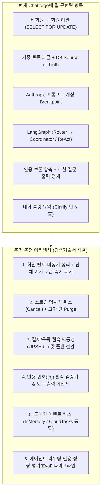

# Chatforge 포트폴리오 취약점 진단 및 아키텍처 고도화 가이드

현재 [`README.md`](../README.md)와 백엔드 구현은 실무 경험과 경력기술서의 핵심 문제의식을 높은 밀도로 재현하고 있습니다. 특히 **비회원→회원 이관(Claim)**, **DB 기준 가중 토큰 과금**, **프롬프트 캐싱 Breakpoint 설계**, **LangGraph ReAct 에이전트 + 프리페치 병렬 코디네이터**, **Decision Docs 기반 테스트 추적**은 면접관에게 강한 인상을 줄 수 있는 수준입니다.

다만 시니어 백엔드/AI 엔지니어 면접관이 코드를 깊게 파고들었을 때 지적할 수 있는 **보안·동시성·정합성 취약점 7가지**와, 경력기술서에는 적혀 있으나 아직 `chatforge`에 코드로 연결되지 않은 **아키텍처 6가지**를 정리했습니다.

---

## Part 1. 코드 레벨 취약점 및 엣지 케이스 진단 (면접 방어 포인트)

> [!IMPORTANT]
> 아래 항목들은 단순 기능 누락이 아니라, `chatforge`가 직접 표방하는 설계 원칙(쿼터 우회 방지, 스트리밍 정합성, 프롬프트 캐싱, Redis 장애 격리)의 **경계 조건(Edge Case)에서 발생하는 실제 취약점**들입니다.

### 1. [보안/인프라] `X-Forwarded-For` 스푸핑을 통한 게스트 무제한 생성 (쿼터 우회)
- **위치**: [`backend/Dockerfile`](../backend/Dockerfile#L24-L25), [`backend/app/routers/auth.py`](../backend/app/routers/auth.py#L25-L28)
- **원인**:
  - `Dockerfile`에서 Uvicorn을 `--proxy-headers --forwarded-allow-ips="*"`로 실행하고, `create_guest`에서 `request.client.host`로 IP당 시간당 게스트 생성 횟수(`guest-create:{ip}`)를 제한합니다.
  - Uvicorn의 `ProxyHeadersMiddleware`는 `--forwarded-allow-ips="*"`일 때 `X-Forwarded-For` 헤더의 **첫 번째(가장 왼쪽) IP**를 `request.client.host`로 신뢰합니다.
  - 그러나 Cloud Run(Google Front End)은 클라이언트가 보낸 `X-Forwarded-For`를 덮어쓰지 않고 **뒤에 실제 클라이언트 IP를 append**(`X-Forwarded-For: <속인_IP>, <실제_클라이언트_IP>`)합니다.
- **영향**: 공격자가 요청마다 임의의 `X-Forwarded-For: 1.2.3.x` 헤더를 보내면 `guest-create:{ip}` Rate Limit을 100% 우회하여 무제한으로 게스트 토큰과 일일 토큰 쿼터를 발급받을 수 있습니다.
- **추가 취약점**: `/auth/login`, `/auth/signup`에는 Rate Limit이 전혀 없어 무차별 대입(Credential Stuffing) 및 Argon2 해싱 연산을 이용한 CPU 고갈 DoS 공격에 노출되어 있습니다.
- **개선 방향**:
  - 클라이언트 IP 추출 헬퍼(`get_client_ip(request)`)를 두어 Cloud Run 환경에서는 `X-Forwarded-For`의 신뢰할 수 있는 프록시 직전 엔트리를 읽도록 고정.
  - `/auth/login` 및 `/auth/signup`에도 IP·이메일 기준 Rate Limit 추가.

---

### 2. [동시성/과금] 스트리밍 중 병렬 요청을 통한 일일 쿼터 대량 초과 (Time-of-Check to Time-of-Use)
- **위치**: [`backend/app/routers/conversations.py`](../backend/app/routers/conversations.py#L146-L155), `_persist_reply` ([`conversations.py`](../backend/app/routers/conversations.py#L369-L402))
- **원인**:
  - `send_message`는 스트림 시작 **직전**에 `ctx.quota.status()`만 조회하고, 실제 사용량 차감(`ctx.quota.add_usage`)은 스트림이 **모두 끝난 뒤** `_persist_reply`에서 수행합니다.
  - 에이전트 턴은 최대 `agent_turn_timeout_seconds = 240초`까지 지속될 수 있습니다.
- **영향**:
  - 잔여 쿼터가 단 10토큰 남은 사용자가 분당 허용치(`requests_per_minute = 20`)만큼 **동시에 20개의 스트리밍 요청**을 보내면, 첫 번째 응답이 끝나기 전에 20개 요청 모두 `quota.exceeded == False`를 통과합니다.
  - 더구나 한 대화(`conversation_id`)에 동시에 두 요청을 보내면 `_allocate_seq`는 짧은 트랜잭션(152~155행)으로 `seq=1(user)`, `seq=2(user)`를 연속 할당한 뒤 각자 스트리밍을 시작해 대화 순서(`user → user → assistant → assistant`)가 뒤엉킵니다.
- **개선 방향**:
  - **대화 단위 동시 스트리밍 락(In-flight Conversation Lock)**: 동일 `conversation_id`에 대해 진행 중인 스트림이 있으면 `409 Conflict` (`stream_in_progress`) 반환 (Redis `SET NX EX` 또는 DB Lock).
  - **토큰 사전 예약(Token Reservation) 또는 동시 실행 수 제한**: 사용자별 동시 스트리밍 수를 1~2개로 제한하거나, 예상 최소/최대 토큰을 선점(Reservation) 후 종료 시 정산(Settlement).

---

### 3. [스트리밍/정합성] 첫 80자(`HOLDBACK_CHARS`) 이전 중단·오류 시 고아(Orphan) User 메시지 발생 및 연속 User 턴 버그
- **위치**: [`backend/app/routers/conversations.py`](../backend/app/routers/conversations.py#L152-L162), [`backend/app/agent/stream.py`](../backend/app/agent/stream.py#L45-L66), `_persist_reply` ([`conversations.py`](../backend/app/routers/conversations.py#L387-L396))
- **원인**:
  1. `send_message`는 스트리밍 시작 전에 **이미 `user` 메시지(`seq=1`)를 DB에 commit하고 `HistoryCache`에 append**합니다.
  2. `AgentStream`은 도구 호출 서두("찾아볼게요") 노출을 막기 위해 처음 80자(`HOLDBACK_CHARS = 80`)를 `self._held`에 보류합니다.
  3. 그런데 `stream.partial` 프로퍼티는 `"".join(self.streamed)`만 반환하고 **`self._held`에 쌓인 텍스트는 버립니다.**
  4. 만약 모델이 70자를 생성하던 중 네트워크가 끊기거나 LLM 오류가 나면 `partial == ""`이 되어 `_persist_reply`에서 `assistant` 메시지를 저장하지 않습니다.
- **영향 (3중 연쇄 버그)**:
  1. **연속 `user` 메시지 발생**: 다음 턴에 사용자가 다시 질문하면 DB와 `HistoryCache`에 `seq=1 (user)`, `seq=2 (user)`가 연속으로 쌓입니다. Anthropic API는 연속된 `user` 역할 메시지를 거부하거나 병합 규칙이 깨져 `to_messages`의 프롬프트 캐시 Breakpoint(`len(turns) - 2`)가 어긋납니다.
  2. **대화 제목 영구 미생성**: 첫 질문(`seq=1`)이 실패한 뒤 재질문하면 `seq=2`가 되어 `is_first_message = (seq == 1 and conversation.title is None)` 조건이 영원히 `False`가 되므로, 해당 대화는 평생 자동 제목이 생성되지 않습니다. (실무에서 취소 시 `user + assistant` 메시지를 함께 정리해 첫 턴 판정을 보존했던 것과 동일한 문제입니다.)
  3. **Holdback 구간 과금 누락**: 79자까지 생성하고 연결을 끊으면 `partial`이 빈 문자열이라 출력 토큰이 1토큰으로 과소 추정됩니다.

---

### 4. [비동기/생명주기] `_stream_agent_reply` 내 `asyncio.shield`의 불완전한 보호
- **위치**: [`backend/app/routers/conversations.py`](../backend/app/routers/conversations.py#L275-L280)
- **원인**:
  ```python
  except (asyncio.CancelledError, GeneratorExit):
      partial = stream.partial
      await asyncio.shield(_persist_reply(...))
      raise
  ```
  - Python 비동기 제너레이터가 `GeneratorExit`를 받을 때 내부에서 비동기 I/O(`await`)를 수행하는 동안 태스크 취소가 겹치거나, `shield()`로 감싼 코루틴이 백그라운드 Task 참조 목록(예: `InlineTaskQueue._running`)에 등록되지 않으면 이벤트 루프가 해당 코루틴의 강한 참조(strong reference)를 유지하지 않아 완료 전 GC되거나 서버 종료 시 유실될 수 있습니다.

---

### 5. [프롬프트 캐싱] 대화 요약(`Conversation.summary`) 결합 방식으로 인한 System 프롬프트 캐시 분리
- **위치**: [`backend/app/services/summary.py`](../backend/app/services/summary.py#L63-L66), [`backend/app/agent/graph.py`](../backend/app/agent/graph.py#L192-L193)
- **원인**:
  - `summary.system_prompt()`는 `settings.system_prompt + SUMMARY_SECTION.format(summary=conversation.summary)`로 **System 프롬프트 문자열 자체를 변경**합니다.
  - 요약이 갱신될 때마다 System 프롬프트 해시가 바뀌어 정적 지시문(`system_prompt + TOOLS_NOTE`)과 요약문을 별도 블록으로 분리했을 때 얻을 수 있는 고정 prefix 캐시 이점이 줄어듭니다.
  - 또한 `agent()` 노드가 도구 호출(ReAct)을 여러 라운드 돌 때, 라운드 1에서 생성된 `scratch`(`AIMessage(tool_calls)` + `ToolMessage`)에는 캐시 Breakpoint가 없어 라운드 2, 3에서 큰 도구 결과(`ToolMessage`)를 매번 캐시 없이 재전송합니다.

---

### 6. [컨텍스트 폭주] ReAct 도구 호출 결과(`ToolOutput`)에 압축/길이 예산(`grounding_char_budget`) 미적용
- **위치**: [`backend/app/agent/tools.py`](../backend/app/agent/tools.py#L29-L41), [`backend/app/services/past_conversations.py`](../backend/app/services/past_conversations.py#L45-L55)
- **원인**:
  - `coordinator` 노드가 실행하는 `RagPipeline.gather()`는 `grounding_char_budget = 1500`을 넘으면 LLM 요약 또는 길이 절삭(`per_source`)을 수행합니다.
  - 반면 ReAct 에이전트가 직접 호출하는 도구(`search_help`, `search_past_conversations`)는 `ToolOutput.of(hits)`로 **원문 전체(`h.text`)를 그대로** `ToolMessage`에 넣습니다.
  - 특히 `search_past_conversations`는 과거 메시지(`Message.content`, 최대 수만 자 가능)를 자르지 않고 반환하므로, 에이전트가 3라운드 × 4회 도구를 호출하면 수만 토큰이 프롬프트에 그대로 주입됩니다.

---

### 7. [장애 대응] `RedisGuard` 단일 오류 시 전역 서킷 오픈 및 소켓 타임아웃 미설정
- **위치**: [`backend/app/main.py`](../backend/app/main.py#L43), [`backend/app/services/redis_guard.py`](../backend/app/services/redis_guard.py#L20-L36)
- **원인**:
  - `main.py`에서 `Redis.from_url(settings.redis_url, decode_responses=True)`에 `socket_connect_timeout`, `socket_timeout`이 지정되어 있지 않아 OS 기본 TCP 타임아웃(수초~수십 초)에 의존합니다(README에 적힌 "첫 바이트까지 8.4초"의 근본 원인).
  - `RedisGuard`는 단 **1번의 일시적 `RedisError`**(예: 유휴 커넥션 리셋)만 발생해도 프로세스 전체의 Redis를 10초간 차단(Open)하며, 이 10초 동안 모든 Rate Limit이 무방비(`fail-open`)가 됩니다.
- **개선 방향**: `socket_connect_timeout=0.5`, `socket_timeout=0.5`, `health_check_interval=30` 설정 + 연속 실패 임계치(`failure_threshold=3`) 및 Half-Open 상태 전이 도입.

---

## Part 2. 포트폴리오 가치를 높이기 위해 추가 추천하는 아키텍처 (실무·경력기술서 연계)

현재 경력기술서에 작성된 핵심 성과들과 `chatforge` 구현 상태를 대조해 보면 아래 표와 같습니다. **미구현/부분 구현된 항목들을 `chatforge`에 아키텍처로 추가**하면, 면접에서 "경력기술서에 적은 모든 내용을 제 포트폴리오 레포지토리에서 실제 동작하는 코드와 테스트로 확인하실 수 있습니다"라고 말할 수 있게 됩니다.



### 추천 1. 회원 탈퇴 비동기 파이프라인 & 전체 기기 토큰 즉시 무효화
- **연계 경력**:
  - *"회원 탈퇴 시 외부 검색 문서 삭제로 발생하던 3분 30초 블로킹을 fire-and-forget으로 해소"*
  - *"보안: 탈퇴 시 모든 기기 토큰 무효화"*
  - README 한계점: *"Access token만 있고 refresh token과 토큰 폐기(revocation)는 없습니다."*
- **추천 아키텍처**:
  1. `users` 테이블에 `token_version`(또는 `deleted_at`) 추가 + JWT `ver` 클레임 도입, 혹은 Redis Revocation Set(`revoked_user:{user_id}`) 캐싱.
  2. `DELETE /auth/me` 호출 시:
     - **동기(트랜잭션 내, < 20ms)**: 회원 소프트 삭제(또는 자격 증명 파기) + Redis에 즉시 토큰 폐기 마킹(모든 기기의 기존 Access Token 즉시 `401` 차단).
     - **비동기(`TaskQueue` Enqueue)**: 대량의 대화/메시지 하드 삭제, `HistoryCache` 패턴 삭제(`SCAN` + `UNLINK`), 외부 검색 인덱스 문서 삭제를 백그라운드 태스크(`purge_user_data`)로 위임.
- **포트폴리오 효과**: README의 첫 번째 한계점을 해소함과 동시에, 경력기술서의 "3분 30초 → 비동기 해소" 및 "보안 토큰 무효화" 사례를 완벽히 증명합니다.

---

### 추천 2. 스트림 취소(Cancel) 정합성 보장 및 Turn Purge 메커니즘
- **연계 경력**: 스트림 취소 시 `user + assistant` 메시지 일괄 정리 및 `turn_index` 기반 정확한 타겟팅
- **추천 아키텍처**:
  1. Part 1의 **취약점 3, 4번**을 근본적으로 해결하는 아키텍처입니다.
  2. 사용자가 답변 생성 중 중지(Abort)하거나 첫 토큰 생성 전에 실패했을 때의 정책을 명확히 분리합니다:
     - **Case A (부분 응답이 생성된 후 중지 — `Holdback` 버퍼 포함)**: `stream.partial_including_held`를 assistant 메시지로 저장하고 추정 토큰 과금.
     - **Case B (아무 응답도 생성되기 전 취소/실패)**: 이미 들어간 `user` 메시지가 홀로 남아 다음 턴의 LLM 메시지 교대 규칙(`user`/`assistant` alternation)과 `is_first_message` 판정을 깨뜨리지 않도록, 해당 턴을 롤백/Purge하거나 다음 턴 진입 시 미응답 `user` 턴을 병합/정리.
  3. 멀티 인스턴스(Cloud Run) 환경에서도 취소 요청(`POST /conversations/{id}/cancel` 또는 `AbortSignal`)이 즉시 그래프 루프를 중단시키도록 `turn_seq` 기반 취소 플래그 확인 추가.

---

### 추천 3. 결제/구독 영수증·웹훅 멱등성(UPSERT) 및 플랜 전환 모듈
- **연계 경력**:
  - *"별도 결제 서비스를 단계별로 이관하며 트랜잭션과 멱등성 개선, Apple 영수증 중복 처리를 UPSERT로 해결, 단위·통합 테스트 112개 작성"*
  - *"구독자 한도 미적용 버그 수정"*
- **현재 아쉬운 점**: `chatforge`에는 `free`(20만 토큰)와 `pro`(200만 토큰) 플랜 개념이 `config.py`와 `quota.py`에 구현되어 있으나, 정작 **사용자가 `free` → `pro`로 전환하거나 결제 웹훅을 처리하는 API/테이블이 없습니다.**
- **추천 아키텍처**:
  1. `subscriptions` (또는 `payment_events`) 테이블 추가 (`transaction_id` UNIQUE 제약).
  2. `POST /billing/receipts` 또는 `POST /webhooks/billing` 엔드포인트 구현:
     - 동일 `transaction_id`(Apple/Stripe 영수증 재전송 시뮬레이션)가 동시에 여러 번 들어와도 PostgreSQL/SQLite `INSERT ... ON CONFLICT (transaction_id) DO UPDATE`로 **멱등성(Idempotency)** 보장.
     - 같은 트랜잭션 안에서 `User.plan = "pro"` 변경 후 커밋 직후 `quota.invalidate()` 호출하여 **구독 즉시 한도가 상향**되도록 구현.
- **포트폴리오 효과**: 코드 양은 100줄 내외로 작지만, 경력기술서의 결제 이관·멱등성·UPSERT·구독자 한도 반영 스토리를 `chatforge` 안에서 완결된 루프로 보여줄 수 있습니다.

---

### 추천 4. 사후 인용 번호(`[n]`) 검증기 및 ReAct 도구 출력 예산(Budget) 통제
- **연계 경력**:
  - README 한계점: *"답변의 `[n]` 인용이 실제로 있는 출처 번호인지는 아직 검증하지 않습니다."*
  - *"논문 검색 결과가 메인 LLM 컨텍스트를 과도하게 차지 → 경량 모델로 1,000자 이내 요약하되 인용 정보 보존"*
- **추천 아키텍처**:
  1. **사후 인용 정합성 필터(`filter_valid_citations`)**:
     - 스트리밍 완료 시점(`_finish_reply`)에 최종 답변 본문에 등장한 `[n]` 번호와 실제 `stream.citations` 목록을 대조하여, 존재하지 않는 번호(`[99]`)에 대한 환각 표기를 로그로 남기고 UI `citations` 메타데이터에서 실제 인용된 출처 여부를 표시(`cited_in_text: bool`).
  2. **ReAct 도구 결과 토큰 예산제**:
     - `agent/tools.py`의 `ToolOutput.render()`에서 단일 도구 호출당 최대 문자 수(`tool_output_char_budget`)를 강제하고, 필요시 `RagPipeline._compress`를 재사용하여 ReAct 루프 중 컨텍스트 폭발을 방지.

---

### 추천 5. 도메인 이벤트 버스 (`EventBus` 프로토콜) 도입으로 모듈러 모놀리스 구조 명확화
- **연계 경력**:
  - *"마이크로서비스를 모듈러 모놀리스로 통합: 공용 커널을 먼저 구축한 뒤 서비스를 단계별로 하나의 앱 모듈로 이관하고, Pub/Sub self-loop를 인메모리 이벤트 버스로 대체"*
- **추천 아키텍처**:
  - 현재 `conversations.py` 라우터가 `tasks.enqueue("generate_title", ...)`와 `tasks.enqueue("summarize_conversation", ...)`를 직접 호출하고, `auth.py`가 `quota.invalidate`와 `history.invalidate_owner`를 직접 호출하고 있습니다.
  - 이를 도메인 이벤트(`GuestClaimed`, `TurnCompleted`, `UserDeleted`)로 추상화하여 가벼운 이벤트 디스패처(프로세스 내 핸들러 + `TaskQueue` 백그라운드 핸들러 연결)로 분리하면, 경력기술서 첫 문단에 적힌 **"모듈러 모놀리스 + 이벤트 버스 아키텍처"** 질문에 대해 `chatforge` 코드를 바로 제시하며 설명할 수 있습니다.

---

### 추천 6. 에이전트 오프라인 평가(Evaluation) 스크립트 및 벤치마크 리포트
- **연계 계획([`plan/261028_langgraph_agent.md`](261028_langgraph_agent.md#L35))**:
  - *"PR E — PubMed 도구와 평가 파이프라인"*
- **추천 아키텍처**:
  - LLM 에이전트 백엔드 채용에서 가장 변별력이 높은 요소는 **"프롬프트나 라우터 모델을 바꿨을 때 품질과 지연을 어떻게 정량 검증했는가?"**입니다.
  - `backend/eval/` (또는 `scripts/evaluate_agent.py`)에 골든 데이터셋(`golden_cases.jsonl` 30~50건: 스몰토크, 도움말 질문, 내 계정 질문, 지난 대화 참조, 모호한 대명사 질문, 프롬프트 인젝션 시도)을 두고 다음 지표를 산출하는 CLI를 추가합니다:
    1. **Router Classification Accuracy**: `needs_search`, `needs_account`, `needs_past`, `needs_clarification` 각각의 Precision / Recall.
    2. **Citation Faithfulness**: 답변에 포함된 `[n]`이 제공된 출처 범위 내에 있는지, 필수 출처 번호를 빠뜨리지 않았는지 비율.
    3. **Latency & Cost Breakdown**: 라우팅 시간(`router_ms`), 병렬 검색 시간(`retrieve_ms`), 가중 과금 토큰(`billed_tokens`) 분포.

---

## Part 3. 우선순위 로드맵 요약

| 우선순위 | 구분 | 항목 | 기대 효과 (면접/포트폴리오) | 예상 작업량 |
|---|---|---|---|---|
| **P0** | 취약점 수정 | **Holdback 구간 중단/실패 시 고아 `user` 메시지 및 제목 누락 수정** (Part 1-3) | 대화 상태 정합성, 연속 `user` 턴으로 인한 Claude API 에러 방지, 실무 취소 버그 해결 사례와 직결 | 소 (반나절) |
| **P0** | 취약점 수정 | **동일 대화 동시 스트리밍 락 & IP 추출(`X-Forwarded-For` 우회) 보안 패치** (Part 1-1, 1-2) | 백엔드 기본기(동시성·보안·프록시 헤더 이해도) 완벽 방어 | 소 (반나절) |
| **P1** | 아키텍처 추가 | **회원 탈퇴 비동기 정리 + 토큰 즉시 폐기(`token_version`)** (Part 2-1) | README 한계점 제거 + 경력기술서의 "3분 30초 블로킹 해소" 및 "보안 토큰 무효화" 증명 | 중 (1일) |
| **P1** | 아키텍처 추가 | **결제/구독 영수증 UPSERT 멱등성 + `pro` 플랜 전환 API** (Part 2-3) | 경력기술서의 결제 이관/UPSERT 경험과 `chatforge`의 플랜별 쿼터 기능을 하나로 연결 | 중 (1일) |
| **P2** | 취약점/품질 | **ReAct 도구 출력 길이 예산제 + 사후 인용 번호(`[n]`) 검증** (Part 1-6, Part 2-4) | README 한계점 제거 + 에이전트 비용/컨텍스트 안전장치 완성 | 소 (반나절) |
| **P2** | 아키텍처 추가 | **에이전트 정량 평가(`eval`) 파이프라인 구축** (Part 2-6) | AI 엔지니어링 역량(정량적 품질 검증) 어필 | 중 (1일) |

